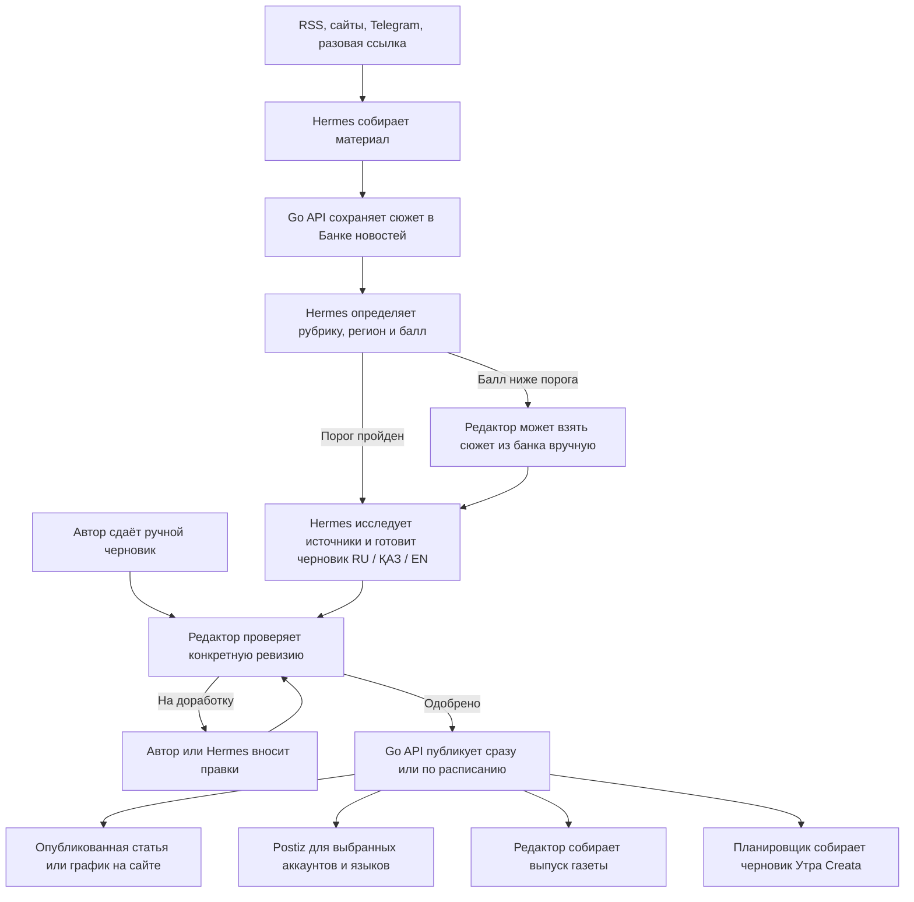
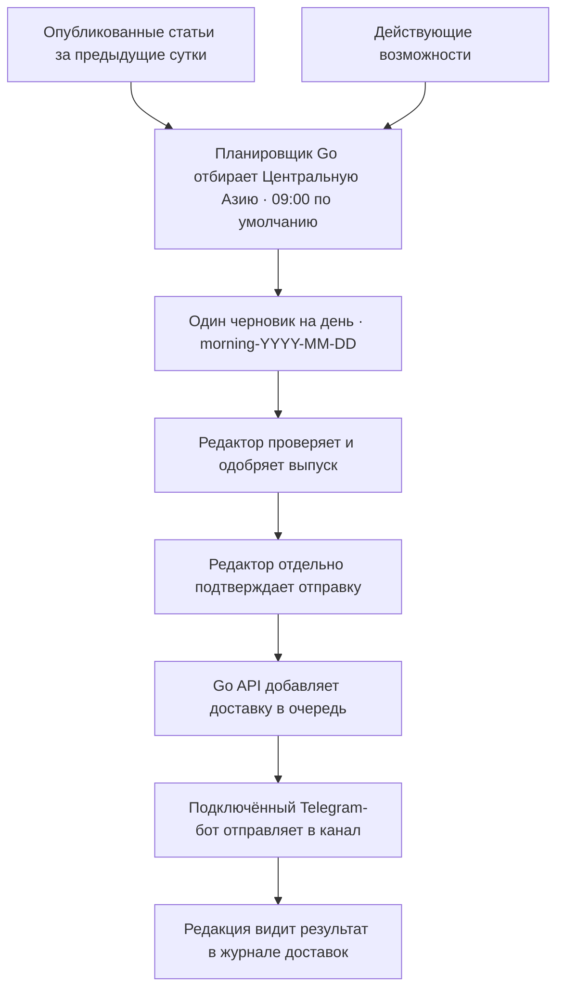
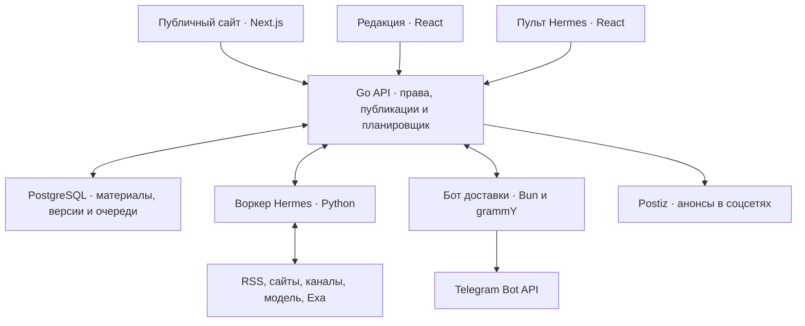

# CR≡ATA News

Independent RU / ҚАЗ / EN editorial news platform. Hermes collects and researches stories. Editors approve a specific revision for the website and select social accounts for Postiz. The API scheduler builds the daily Central Asia edition of Creata Morning for editorial review. The [Russian pipeline guide](docs/PIPELINE.md) covers the workflow, local startup, delivery states and verification.

[Схема пайплайна](#весь-пайплайн-creata-news) · [Как запустить](#как-запустить-локально) · [Шаги пайплайна](#от-источника-до-публикации) · [Компоненты](#что-за-что-отвечает) · [Схема дайджеста](#схема-утра-creata) · [Проверки](#verification) · [Деплой](#docker-deployment) · [API и данные](#api-and-data)

## Весь пайплайн Creata News



**Источник → сбор Hermes → Банк новостей → отбор и исследование → черновик → проверка редактором → публикация на сайте.** Опубликованные материалы могут войти в газету или дайджест. Анонсы в соцсетях и отправка в Telegram идут по отдельным очередям.

## Как запустить локально

Для первого запуска нужны **Bun, Go, Python с `venv` и Docker с Compose**. Выполните команды из корня репозитория.

```sh
bun install --frozen-lockfile
bun run setup:local
docker compose up -d --wait postgres
bun run dev
```

`setup:local` создаёт частный `.env` при первом запуске. `bun run dev` компилирует Go API и поднимает сайт, обе админки, воркер Hermes и Telegram-бота. При следующем запуске достаточно `bun run dev`. Команда печатает адреса и сохраняет их в `.runtime/local-ports.json`. Держите API запущенным, чтобы работало расписание, включая «Утро Creata».

### Что открыть после запуска

| Куда зайти | Что проверить |
|---|---|
| [Редакция → Сегодня](http://localhost:6868/today) | Локальный вход по роли, очередь материалов и последние данные «Утра Creata». |
| [Hermes → Источники](http://localhost:5174/sources) | Добавить источник как администратор, запустить сбор и посмотреть результат в [«Заданиях»](http://localhost:5174/jobs). |
| [Редакция → Банк новостей](http://localhost:6868/bank) | Увидеть собранный сюжет, открыть подтверждения и взять материал в работу. |
| [Публичный сайт](http://localhost:3002/ru) | Открыть статью после одобрения и публикации в редакции. |
| [Редакция → Дайджесты](http://localhost:6868/digests) | Собрать ручной выпуск для проверки или открыть ежедневный черновик, когда наступит час сборки. |

Адреса в таблице используют стандартные порты. Если порт занят, ориентируйтесь на `.runtime/local-ports.json`.

### Что нужно для интеграций

- **AI-черновики Hermes.** В «Пульте Hermes → AI-настройки» задайте адрес модели, модель, ключ, стоимость токенов и дневной бюджет. Ключ Exa включает дополнительный поиск подтверждений. [Подробности настройки Hermes](#hermes)
- **Чтение публичных Telegram-каналов.** Настройте сессию коллектора Telethon. У неё свои параметры `TELEGRAM_API_ID` и `TELEGRAM_API_HASH`. [Запуск коллектора](#hermes)
- **Отправка в Telegram.** Укажите `TELEGRAM_BOT_TOKEN` и `CREATA_TELEGRAM_CHANNEL_ID` в `.env`, дайте боту право публикации в канале и перезапустите стек. Сборка «Утра Creata» сохраняет черновик в редакции. [Схема отправки](#схема-утра-creata)
- **Соцсети.** Подключите Postiz в конфигурации API, затем выберите аккаунты и языки в карточке статьи. [Настройки Postiz](#postiz-social-publishing)

Для сквозной проверки используйте `bun run test:pipeline`. Тест поднимает собственный API с отдельной схемой PostgreSQL и имитирует внешние отправки. [Подготовка тестовой базы и команды](#verification)

## От источника до публикации

1. **Подключение источника.** Администратор добавляет RSS, сайт или публичный Telegram-канал, задаёт язык и интервал. Планировщик Go проверяет активные источники при старте и каждые 15 секунд. Редакция также может запустить разовый сбор по URL из «Банка новостей». [Hermes → Источники](http://localhost:5174/sources) · [Редакция → Банк новостей](http://localhost:6868/bank)
2. **Сбор и проверка повторов.** Воркер Hermes забирает задание `collect` и извлекает текст, дату и адрес. API сохраняет оригинал в PostgreSQL и связывает подтверждения с сюжетом. Похожие сюжеты редакция может сравнить, объединить или разделить. Ошибки чтения и предупреждения видны в задании. [Hermes → Задания](http://localhost:5174/jobs)
3. **Отбор сюжета.** Hermes классифицирует находку по рубрике и региону, выставляет балл и объясняет оценку. Сюжет, достигший порога, автоматически получает задание на черновик. Остальные остаются в банке, где можно взять их в работу вручную. Новый материал также можно написать с нуля в редакции. [Hermes → Правила](http://localhost:5174/rules) · [Редакция → Материалы](http://localhost:6868/articles)
4. **Исследование, черновик и проверка.** Hermes читает источники и проверяет, подкреплены ли факты, даты и числа цитатами. При одном читаемом источнике он может поискать подтверждения через подключённый Exa. Затем готовит заголовок и текст на русском, казахском и английском, добавляет ссылки и замечания. Для графика собирает подтверждения чисел. Готовый AI-черновик автоматически попадает на проверку. Бюджет ограничивает расходы, а контрольные точки сохраняют завершённые этапы при повторе задания. [Настройки AI](http://localhost:5174/ai) · [Конвейер Hermes](hermes-worker/hermes/pipeline.py)
5. **Редактура и одобрение.** Автор отправляет на проверку черновик, который написал вручную. Редактор проверяет текст, переводы, источники, права на изображения и данные графика. При возврате с замечанием автор или Hermes готовит правку, и материал снова проходит проверку. Одобрение относится к конкретной ревизии. Сохранение изменений снимает одобрение, а попытка сохранить устаревшую версию возвращает `409`. [Редакция → Сегодня](http://localhost:6868/today) · [Действия над статьями](backend/creata/internal/news/editorial.go)
6. **Публикация на сайте.** Уполномоченный редактор выпускает одобренную ревизию сразу или назначает время. API сохраняет публичный снимок, который сайт показывает на `/{locale}/articles/{slug}` или `/{locale}/charts/{slug}`. Читатель продолжает видеть эту версию, пока новая проходит редактуру. При снятии с публикации редакционная история сохраняется. [Публичный сайт](http://localhost:3002/ru) · [Архив публикаций](backend/creata/internal/news/public_archive.go)

### Куда попадает опубликованный материал

- **Газета.** Редактор вручную выбирает опубликованные статьи, задаёт язык, порядок полос, обложку и фотографии. После предпросмотра главред или администратор публикует номер в `/{locale}/gazeta`. Выпуск хранит собственные копии текстов и медиа. [Редактор газеты](http://localhost:6868/newspapers) · [Как собрать выпуск](docs/NEWSPAPER.md)
- **Соцсети через Postiz.** При публикации или планировании редактор выбирает аккаунты и языки. После выхода ревизии отдельный воркер Go обрабатывает задания. В режиме `draft` Postiz создаёт черновики, в режиме `now` передаёт анонсы на публикацию. Результаты видны в карточке материала по каждому аккаунту и языку. [Очередь Postiz](backend/creata/internal/news/postiz_outbox.go)
- **«Утро Creata».** По умолчанию в 09:00 по часовому поясу редакции планировщик выбирает за предыдущие сутки до пяти опубликованных статей и добавляет до трёх действующих возможностей по Центральной Азии. Создаётся один черновик на русском за календарный день. Перезапуск сохраняет тот же выпуск `morning-YYYY-MM-DD`. Экран «Сегодня» показывает состав, статус и последний успешный сбор Hermes. [Открыть «Дайджесты»](http://localhost:6868/digests) · [Расписание и настройки](#creata-morning-and-telegram-delivery)
- **Отправка в Telegram.** Редактор одобряет выпуск и отдельно подтверждает отправку. Только это подтверждение ставит одобренный канальный выпуск в очередь. Подключённый бот забирает задание и возвращает результат. При неопределённом исходе главред или администратор сверяет отправку в канале. Персональные подборки собираются по языку, темам и частоте подписчика и имеют своё расписание. [Журнал и очередь доставок](backend/creata/internal/news/digests.go)
- **Обновления и аналитика.** После выпуска редакция может назначить повторную проверку развивающегося сюжета, добавить обновление или выпустить исправленную ревизию. Читатели могут сохранять статьи и следить за сюжетом. Просмотры, сохранения и переходы по возможностям помогают редакции видеть результат. [Развитие сюжета](http://localhost:6868/story-follow-ups) · [Аналитика](http://localhost:6868/analytics)

### Схема Утра Creata



## Что за что отвечает



| Компонент | Адрес по умолчанию | Задача и исходники |
|---|---|---|
| **Сайт** | <http://localhost:3002/ru> | Next.js App Router, React 19 и TypeScript показывают опубликованные страницы на трёх языках, каталоги и функции читателя. [`creatanews/`](creatanews/) |
| **Редакция** | <http://localhost:6868/today> | React, Vite, TanStack Router и Query. Редактор ведёт материалы, версии, выпуск, газету и дайджесты в `src/creata`. [`events-admin/`](events-admin/) |
| **Пульт Hermes** | <http://localhost:5174/sources> | Режим общей React-админки для управления источниками, запусками, заданиями, AI и ошибками. [`agent-admin/`](agent-admin/) |
| **Go API** | <http://localhost:5555/health> | Go 1.26. `cmd/server` поднимает HTTP и планировщик, `internal/news` проверяет права, сохраняет версии и управляет заданиями через pgx. [`backend/creata/`](backend/creata/) |
| **PostgreSQL** | `127.0.0.1:54328` в Compose | PostgreSQL 16 хранит сессии, материалы, версии, задания, подтверждения источников, аналитику и учёт расходов AI. [Схема SQL](backend/creata/internal/news/schema.sql) |
| **Воркер Hermes** | Фоновый процесс Python | Забирает задания из API, читает источники, классифицирует, исследует, готовит черновики и замечания. Telegram-источники читает через Telethon. [`hermes-worker/`](hermes-worker/) |
| **Бот доставки** | <http://localhost:3031/health/live> | Bun и grammY. Привязывает аккаунты, обслуживает личные предпочтения, забирает задания на отправку и возвращает их результат через API. [`telegram-bot/src/creata/`](telegram-bot/src/creata/) |

The repository uses Bun workspaces. [`packages/contracts`](packages/contracts/) contains generated OpenAPI types and the shared HTTP client. [`packages/brand`](packages/brand/) owns the logo and shared branding, [`packages/graphics`](packages/graphics/) owns chart data validation, CSV and SVG rendering, and [`packages/demo-pipeline`](packages/demo-pipeline/) implements the browser-local demo. [`scripts/`](scripts/) contains launchers, seed generation, contract generation, demo packaging and integration fixtures. The isolated Creata API uses its own PostgreSQL schema and migration entry point.

Visual implementation preserves the original public frontend and admin component owners. All three apps share `@creata/brand`: Creata violet, neutral surfaces, the existing local Manrope/Kazakh fonts and one logo. The public app uses the original Spotlight/poster rail and a single compact navigation; admin workflows use the original Sidebar and UI primitives. Rest of World and Skiper are supporting references.

## Editorial tools

| Routes in the editorial app | What they manage |
|---|---|
| `/today`, `/bank`, `/articles`, `/articles/{id}` | Daily overview, approved publication and collection metrics, inbox and Kanban, source collection, revisions, preview and publication. |
| `/story-follow-ups` | Deadlines for checking developing stories and recording later developments. |
| `/charts`, `/charts/{id}` | Manual and Hermes-assisted charts backed by article revisions. Import CSV, record methodology and sources, verify values, then approve and publish. Readers can inspect the chart, open its data table or download CSV. |
| `/newspapers` | Manually assembled issues with a number, month, language, cover, ordered published articles and optional per-article photos. Use the staff preview before publishing to `/{locale}/gazeta`. Each edition freezes the selected text and media. The imported №01 is edited through Site Content. |
| `/launches`, `/opportunities`, `/authors` | Founder submissions and moderation, current opportunities with deadlines and application links, and author profiles. |
| `/digests`, `/analytics`, `/audit` | Digest previews and delivery history, audience and workflow metrics, and the staff audit log. |
| `/content`, `/media`, `/settings` | About and ecosystem content and original newspaper issue, media and usage rights, newsroom settings and team roles. |

In Hermes, `/sources` manages active sources and collection intervals, `/runs` and `/jobs` show execution history, `/charts` queues a chart from a collected story, `/rules` and `/ai` configure selection and generation, and `/errors` shows failures.

### Public site

All public pages use `/{locale}` with `ru`, `kk` or `en`. The main menu exposes Home, Newspaper, Opportunities and Startup Launches. It also links to Latest and About. The About page links to the Creata ecosystem, and the reader manages Creata Morning subscriptions in the profile. The direct routes for the second homepage and charts remain available.

| Routes under `/{locale}` | Reader experience |
|---|---|
| `/`, `/v2`, `/latest`, `/categories/{slug}`, `/authors/{id}`, `/search` | Homepage variants, thematic and chronological collections, author collections and search. The legacy `/world` route redirects to Latest with its filters. |
| `/articles/{slug}`, `/charts/{slug}` | Published translations, source references, credited media, correction history and the timeline of a developing story when the editor has added one. |
| `/opportunities/{id}`, `/launches/{slug}` | Opportunity details and application links, launch cards, votes and comments. Signed-in founders can submit launches for editorial review. |
| `/gazeta`, `/gazeta/{issue}`, `/about`, `/ecosystem` | Newspaper archive and issues, and published site content. |
| `/profile`, `/saved`, `/following` | Identity and preferences, saved articles and opportunities, followed stories and unread updates. |

The region menu uses `central-asia` and the country codes `KZ`, `KG`, `TJ`, `TM` and `UZ`. The aggregate covers Kazakhstan, Kyrgyzstan, Tajikistan, Turkmenistan and Uzbekistan. Use a query such as `/ru/latest?region=UZ` for an individual country. Article and newspaper previews have separate authenticated staff routes. Popular stories use accepted view events over the last seven days.

## Native local development

Requirements: Bun 1.4.2, Go (version in backend/creata/go.mod), Python with venv (3.12 verified locally, 3.13 in CI), Docker with Compose for the standard project database.

The complete native stack starts with `bun run dev` (or `bun run dev:all`). The launcher checks the database connection and starts the existing project PostgreSQL container when its local port is down.
It starts API, public site, both admins, Hermes and the delivery bot; chooses free
IPv4/IPv6 ports; and writes the actual URLs to `.runtime/local-ports.json`.
Set `CREATA_PYTHON` when Python is installed outside PATH. Optional fixed ports
are `CREATA_API_PORT`, `CREATA_WEB_PORT`, `CREATA_EDITORIAL_PORT`,
`CREATA_HERMES_PORT`, `CREATA_BOT_PORT`. An occupied fixed port produces a clear
error and leaves other projects running. The default bot port is now **3031**.

The launcher checks Python and the pinned Telethon dependency. It can create or repair the project environment in `.runtime/hermes-venv`. An explicitly configured external interpreter needs the dependencies in `hermes-worker/requirements.txt`. Bot delivery uses Bun and its own Telegram bot token.

Original ecosystem/about/newspaper content and business assets are imported
idempotently from `backend/creata/content` into PostgreSQL and API/S3 storage.
Edit published pages in **Контент сайта** and manage assets and rights in
**Медиатека**. Old media URLs resolve through the API. Local `uploads/` holds
runtime data and is ignored by Git. Keep it with the local PostgreSQL backup.

Hermes uses `CREATA_WORKER_STATE_DIR` for its durable paid-response outbox during
API interruptions; Compose mounts a separate `hermes-state` volume. Keep this
directory persistent. AI endpoint/model/key and budget can be configured later.

For the Compose setup, `bun run setup:local --test-db` provisions the sibling `creata_test` database and records its address in the private environment. `bun run test:pipeline` starts its own API, builds and serves the public site, and exercises Hermes, editorial approval, Postiz, Telegram and both administrative apps using local HTTP fixtures. CI runs the same command.

See [the local startup commands](#как-запустить-локально).

`bun run dev:api` remains available for backend-only work. `bun run dev:ui`
starts only the three frontend packages when an API is already managed separately.

The setup command creates a private `.env` with independent random service secrets and preserves an existing file. It enables **local loopback-only development sign-in** for testing roles. Production rejects this mode. New article banks start empty; original supplied company pages and newspaper №01 migrate as existing approved content. Demo news and statistics are never created automatically.

To use the supplied reference content explicitly in development:

```sh
bun run seed:dev
# Stop a running API first, then start it with the seed:
bun scripts/run-api.ts -seed /absolute/path/to/.runtime/dev-seed.json
```

The seed imports eight reference articles, 19 categories, 10 authors and six demo opportunities with the original prototype photos and localized audiences. Five opportunities are approved, including the Creata Games hackathon. The “Mama Pro” hackathon retains its pending review status and stays private. Confirm reuse rights before publishing reference media. The production executable refuses development seeding.

### Configuration map

Start from [`.env.example`](.env.example). Keep the generated `.env`, provider tokens and Telegram session files private. The AI provider and Exa keys are entered through Hermes settings.

| Area | Settings |
|---|---|
| PostgreSQL and runtime | `DATABASE_URL`, `POSTGRES_PASSWORD`, optional `CREATA_DATABASE_PORT` for Compose, and loopback `CREATA_TEST_DATABASE_URL` for integration tests. |
| App URLs and proxy | `CREATA_API_URL`, `CREATA_API_ORIGIN`, `CREATA_PUBLIC_URL`, `CREATA_EDITORIAL_URL`, `CREATA_HERMES_ADMIN_URL`, `CREATA_ORIGINS`, `CREATA_COOKIE_DOMAIN`, `CREATA_TRUSTED_PROXIES`. |
| Service credentials | `CREATA_SESSION_SECRET`, `CREATA_WORKER_TOKEN`, `CREATA_BOT_SERVICE_TOKEN`, and `CREATA_SSR_TOKEN` for server-rendered reads. Use distinct credentials of at least 32 characters. |
| OAuth | `CREATA_GOOGLE_CLIENT_ID`, `CREATA_GOOGLE_CLIENT_SECRET`, `CREATA_TELEGRAM_CLIENT_ID`, `CREATA_TELEGRAM_CLIENT_SECRET`. |
| Media | `CREATA_MEDIA_DIR` for local files. S3 uses `CREATA_S3_ENDPOINT`, `CREATA_S3_REGION`, `CREATA_S3_BUCKET`, `CREATA_S3_ACCESS_KEY` and `CREATA_S3_SECRET_KEY`. `CREATA_MEDIA_PUBLIC_URL` selects the public bucket or CDN origin when configured. |
| Background jobs | `CREATA_PYTHON`, `CREATA_WORKER_STATE_DIR` and optional `CREATA_WORKER_ID`. Configure the AI endpoint, model, key, token prices, budget, optional Exa key and editorial selection threshold in Hermes. |
| Telegram collection | `TELEGRAM_API_ID`, `TELEGRAM_API_HASH` and `TELEGRAM_COLLECTOR_SESSION_FILE` or `TELEGRAM_COLLECTOR_SESSION`. |
| Telegram delivery | `TELEGRAM_BOT_TOKEN`, `CREATA_TELEGRAM_BOT_USERNAME`, `CREATA_TELEGRAM_CHANNEL_ID`, optional `CREATA_TELEGRAM_CHANNEL_ONLY`, `TELEGRAM_WEBHOOK_URL` and `TELEGRAM_WEBHOOK_SECRET`. |
| Postiz | `CREATA_POSTIZ_API_URL`, `CREATA_POSTIZ_API_KEY`, `CREATA_POSTIZ_MODE`. |

### Browser-local demo

Building the public app with `NEXT_PUBLIC_CREATA_DEMO_MODE=1` bundles the editorial and Hermes admin apps under `/editorial/` and `/hermes/`. The demo uses reference content and a separate browser-local store. Publishing and deliveries are simulated. Use `bun run demo:stage` to prepare a deployable stage under `.runtime/deploy/`. [Demo build and Vercel packaging](docs/DEMO-VERCEL.md)

## Docker deployment

```sh
bun run setup:local
docker compose up --build -d
```

Compose runs an isolated Creata database, API, three frontends, Hermes worker and digest bot. PostgreSQL and frontend ports bind to loopback. Container development sign-in is disabled because requests arrive through a proxy; use native local development for role testing, or configure OAuth for container use.

For production, set `CREATA_ENV=production`, `CREATA_DEV_AUTH=0`, distinct service/session secrets, exact HTTPS frontend origins and public URLs, OAuth clients, and the HTTPS S3 endpoint, region, bucket, and credentials. Compose passes explicit environment variables to each service. The API alone receives the database, OAuth, S3, and Postiz configuration. Hermes receives the worker credential and Telegram collector configuration. The delivery bot receives the bot credential and Telegram webhook configuration.

Use an HTTPS ingress in front of the loopback-bound services. Set `CREATA_TRUSTED_PROXIES` on the API to the comma-separated CIDRs of the actual ingress and application proxy hops. At the public edge, replace incoming `X-Forwarded-For` with the connecting client's address. Internal proxy hops may append their peer. Restrict access to trusted proxies so clients cannot bypass the edge and send their own forwarded address. Without a configured trusted peer, the API uses the socket address. Set `CREATA_SSR_TOKEN` to the same distinct random value of at least 32 characters on the API and the Next.js server runtime. It gives server-rendered public reads a separate request budget. Use the ingress to enforce limits for visitors of the public site.

For separate production hosts (for example `news.example.com`, `editorial.example.com`, `hermes.example.com`, `api.example.com`), configure `CREATA_COOKIE_DOMAIN=example.com` and matching exact `CREATA_ORIGINS`/`CREATA_API_URL`. All hosts must belong to that cookie domain. Both OAuth state and account cookies use it; cross-host OAuth without a matching domain is rejected. A deployment on one hostname needs no cookie domain. `CREATA_EDITORIAL_URL` and `CREATA_HERMES_ADMIN_URL` set cross-app links when building admin containers.

### Authentication and staff

Configure `CREATA_GOOGLE_CLIENT_ID`, `CREATA_GOOGLE_CLIENT_SECRET`, `CREATA_API_URL`, and Google callback `/api/creata/v1/auth/google/callback`. Telegram website login uses `CREATA_TELEGRAM_CLIENT_ID` and `CREATA_TELEGRAM_CLIENT_SECRET`, callback `/api/creata/v1/auth/telegram/callback`. Unconfigured providers are unavailable in the UI.

After a verified-email account has signed in, bootstrap staff explicitly:

```sh
# From backend/creata with its environment configured:
go run ./cmd/server -grant-admin-email editor@example.com
```

Roles and vertical assignments are managed in the editorial team/settings screen. Google and Telegram subjects are bound to accounts. Matching contact emails alone never merge identities.

| Role | Main permissions |
|---|---|
| `reader` | Read the public site, manage preferences and Telegram linking, save content, follow stories and submit a launch. |
| `author` | Edit and submit their own articles. Read author and opportunity catalogs and digest previews. |
| `editor` | Review, edit and publish articles within assigned world verticals. Edit the author and opportunity catalogs, manage channel editions and read delivery history. |
| `chief_editor` | Review and publish articles across verticals, including ecosystem articles. Manage channel editions, publish newspaper issues, inspect the audit log and resolve failed or uncertain deliveries. |
| `admin` | Manage accounts, team permissions, source configuration and integrations, inspect the audit log and deliveries, and publish newspaper issues. Article publishing still requires the appropriate editorial role and scope. |

Roles can be combined. For local verification, the development `admin` login also grants the chief editor, editor and author roles. The API enforces roles and vertical assignments for both direct requests and UI actions. Hermes uses a separate service credential and writes review drafts. Publication requires an authorized editorial action.

### Hermes

Install its one external integration dependency and start the worker with the same API environment:

```sh
python -m pip install -r hermes-worker/requirements.txt
# Set CREATA_API_ORIGIN and CREATA_WORKER_TOKEN from the private environment.
cd hermes-worker
python -m hermes.main
```

Add sources in the Hermes app. Set an OpenAI-compatible endpoint, model, API key, token prices and a positive daily budget in AI settings. Keys are write-only and encrypted at rest. With no AI configuration, source collection and manual editing work; AI jobs show `not_configured`. Each model request reserves budget before transmission and records actual usage afterward. Unknown provider outcomes conservatively consume the reservation.

Editors can submit an individual URL from the news bank without managing the full source registry. These one-off jobs fetch only the submitted page. Research and review use retrieved evidence texts, and a reference URL without readable evidence never counts as a corroborating source. Provider redirects are refused so authorization headers cannot be forwarded to another origin.

An optional Exa API key in Hermes AI settings enables a search for additional sources during research of collected articles with a single readable source. Hermes fetches the returned pages directly and adds cited, readable results to the draft. Exa usage is billed by Exa separately from the language model budget.

Jobs carry a lease token. Draft and rework jobs also reference the editorial revision they started from. That check protects later human edits from stale worker results. Transient failures can retry with bounded attempts. Investigate exhausted or misconfigured jobs from the Hermes panel. Paid AI checkpoints and the durable worker outbox preserve successful paid results across temporary API interruptions.

RSS and website targets are resolved and pinned to public IPs, bounded in size, and checked again across redirects. Crawlers respect robots.txt. JavaScript-only/paywalled pages report collection failures; no content is invented. The environment flag `CREATA_ALLOW_PRIVATE_SOURCES=1` is restricted to controlled development fixtures and rejected in production.

Telegram source collection is separate from the digest bot. Configure `TELEGRAM_API_ID` and `TELEGRAM_API_HASH`, then authorize a dedicated collector interactively:

```sh
cd hermes-worker
python -m hermes.telegram_login
```

The helper saves a private session file without printing its contents. Set `TELEGRAM_COLLECTOR_SESSION_FILE` to that path, or provide `TELEGRAM_COLLECTOR_SESSION` through your secret store. The collector reads only configured public channel URLs.

### Creata Morning and Telegram delivery

**Creata Morning (`Утро Creata`)** is the daily channel edition. The API builds one Russian draft per newsroom calendar day at or after **09:00** by default. Set the draft hour (`morningDigestHour`) and IANA time zone in Editorial → Settings. The default time zone is `Asia/Qyzylorda`. The API process must be running for scheduled work. If it starts after the configured time, it creates that day's draft during the next scheduler pass.

- The draft uses up to five published articles from the window between the previous and current scheduled cutoff. It also includes up to three approved regional opportunities with future deadlines. Both selections use the five Central Asian countries and the aggregate regional label. A day with no matches still gets an empty draft.
- The edition is stored in PostgreSQL with a date-based ID in the form `morning-YYYY-MM-DD`. Later scheduler passes and process restarts reuse the existing record, including its review state.
- Editorial → Today shows the edition date, status, material counts and the time of the most recent successful Hermes collection. **Open edition** opens the saved preview. Editorial → Digests also supports a manually built regional channel draft and language selection.
- An editor or chief editor approves the edition. **Send to channel** is a separate, explicit confirmation. The scheduler creates the draft without a delivery record. Delivery setup failures are shown near the button, and send errors appear inside the confirmation dialog.

The overview is available at `GET /api/creata/v1/admin/digests/morning`. The digest list carries the server's channel configuration status. [Scheduling and delivery implementation](backend/creata/internal/news/digests.go) · [Daily draft and deduplication](backend/creata/internal/news/morning_digest.go)

Configure `TELEGRAM_BOT_TOKEN`, `CREATA_BOT_SERVICE_TOKEN`, `CREATA_TELEGRAM_BOT_USERNAME`, and the numeric `CREATA_TELEGRAM_CHANNEL_ID`. Make the bot an administrator of the intended channel with permission to post. Use a reachable `CREATA_PUBLIC_URL` for links sent to readers. Native development can use polling. Production requires `TELEGRAM_WEBHOOK_URL` and a 32-character-or-longer `TELEGRAM_WEBHOOK_SECRET`.

```sh
bun run --filter @creata/telegram-bot start
```

Personal digests have their own delivery hour (`digestHour`), language, topics and frequency. The default is 09:00 daily or Friday at 09:00 for weekly subscriptions in the newsroom time zone. Bot commands in personal mode are `/start`, `/digest`, `/settings`, `/pause`, `/resume` and `/help`. Set `CREATA_TELEGRAM_CHANNEL_ONLY=1` on the API and bot to disable personal scheduling and commands while keeping channel editions available.

The bot claims queued deliveries using a lease. A completed delivery records the Telegram message ID and marks the digest sent. Known transient failures may retry. An ambiguous outcome or an expired sending lease is marked `unknown`. A chief editor or administrator checks Telegram and resolves that record from the delivery panel. Confirmed sends are never retried automatically.

### Postiz social publishing

Configure the API server with `CREATA_POSTIZ_API_KEY` and the full Postiz Public API base in `CREATA_POSTIZ_API_URL`. The default is `https://api.postiz.com/public/v1`. In the article or chart editor, approve the revision, choose **Publish** or **Schedule**, then select accounts and languages. The default `CREATA_POSTIZ_MODE=draft` creates a draft on each selected account. Set it to `now` to enable platform delivery after the site publication becomes effective. Account-specific delivery states appear on the material. [Setup, media prerequisites and retry behavior](docs/PIPELINE.md)

## Verification

Run the static and unit checks from the repository root:

```sh
bun scripts/generate-contracts.ts --check
bun run typecheck
bun run build
bun run test
bun test scripts/local-ports.test.ts
bun run test:api
bun run test:hermes
```

Run `bun run contracts` after changing OpenAPI to update the generated types. Set `CREATA_TEST_DATABASE_URL` to a disposable loopback PostgreSQL database whose name includes `test`. Backend integrations create and drop their own schemas. Run `go test -race ./...` and `go vet ./...` from `backend/creata` for additional checks.

Use the following commands for the full isolated run after starting the local PostgreSQL container:

```sh
bun run setup:local --test-db
bunx playwright install chromium
bun run test:pipeline
```

The full runner creates an isolated schema, allocates loopback ports, seeds reference records and starts its own API and frontends. It exercises Hermes and editorial publication, Telegram retry and delivery confirmation, and Postiz through fixtures. It stops the temporary services and drops the test schema on normal exit. [Verification runner](scripts/verify-pipeline.ts)

For browser smoke tests against an existing seeded native stack with development sign-in enabled, run `bun run test:e2e`. The editorial Playwright suite includes role permissions, article workflow, newspaper preview and publishing, story updates, graphics and digest delivery errors. Use the isolated runner for browser suites that mutate records. The smoke runner writes screenshots and results under ignored `.runtime/`. Set `PLAYWRIGHT_BROWSERS_PATH` when using a custom browser cache. [Editorial browser scenarios](events-admin/e2e-creata/) · [Public browser scenarios](creatanews/e2e/)

GitHub Actions checks the generated contract, TypeScript and builds, Bun tests, Go with the race detector, Python worker tests and the isolated browser and provider run. On failure it uploads available browser evidence. [CI workflow](.github/workflows/ci.yml)

Live Google/Telegram authentication, paid AI and actual Telegram sends require operator credentials and are separate from local fixture verification.

## API and data

The HTTP API uses `/api/creata/v1`. It returns JSON, with list responses containing `items` and optional pagination or totals. The contract uses ISO 8601 timestamps and localized fields of the form `{ ru, kk, en }`. The newsroom calendar determines digest dates. Vite proxies `/api` in local admin apps. Next.js talks directly to Go for SSR. Its browser proxy forwards versioned non-internal routes and leaves authorization to the API.

| API family | Key operations |
|---|---|
| `/public/*` | Published articles, charts through the article format filter, categories, authors, regions, search, opportunities, launches, newspaper editions, site content and view events. |
| `/auth/*`, `/account/*` | OAuth, session, CSRF token, profile, saved items, followed stories, Telegram linking and reader interactions. |
| `/admin/articles/*`, `/admin/bank/*` | Editorial revisions, research, article actions, story follow-ups, collection, duplicates and draft creation. |
| `/admin/digests/*`, `/admin/deliveries` | Scheduled overview, manual preview, approval, queueing, delivery history and manual recovery. |
| `/admin/sources/*`, `/admin/jobs/*`, `/admin/settings` | Hermes source configuration, job tracking and retries, newsroom schedules and AI settings. |
| `/admin/newspapers/*`, `/admin/pages/*`, `/admin/media` | Publication and preview of editions and site content, plus media upload and rights. |
| `/admin/authors`, `/admin/opportunities`, `/admin/launches`, `/admin/users` | Editorial catalogs, launch moderation and team management. |
| `/admin/postiz/channels`, `/admin/articles/{id}/postiz` | Connected social accounts and revision-specific delivery history. |
| `/internal/*` | Background claims, leases, heartbeats, completion and AI budget accounting. Separate worker and bot bearer credentials scope these operations. |

Browser mutations send `X-CSRF-Token` from `/auth/me` alongside the session cookie. The API validates configured origins and roles. In production it uses separate budgets for reads, writes, authentication and authorized SSR requests. The public archive filters and pages results in SQL. Article, region and catalog reads use indexed data and conditional ETags where supported. Draft changes leave the published snapshot and its validator in place.

PostgreSQL applies embedded migrations at startup. `creata_records` holds typed JSONB records including drafts, revisions, published snapshots, evidence, jobs, digests and Telegram deliveries. Separate tables hold sessions, fingerprints, AI budget reservations, events and the Postiz outbox. A transaction-scoped advisory lock serializes store writes. Revision checks and lease ownership keep concurrent or retried work consistent. [SQL schema](backend/creata/internal/news/schema.sql) · [OpenAPI contract](backend/creata/openapi.json)

## Data and operations

| Symptom | Check |
|---|---|
| A local app opens on a different port | Read `.runtime/local-ports.json`. The native launcher can choose free ports when no fixed value is configured. |
| API or database unavailable | Check `GET /health` on the API. It verifies the PostgreSQL connection. |
| Hermes collects but leaves a job in `not_configured` | Check the provider endpoint, model, key, token prices and available budget in Hermes → AI. |
| No new automatic morning edition | Confirm the running API, newsroom time zone, draft hour, and the latest edition date and Hermes collection on Editorial → Today. |
| Channel send is disabled | Configure the bot token and channel ID and restart the affected services. Bot `/health/live` reports process liveness. `/health/ready` reports configuration and readiness. |
| Delivery outcome is `unknown` | Check Telegram or Postiz before retrying. Use the delivery ledger to resolve the result. |

Back up PostgreSQL with `pg_dump`, the S3 bucket (or development media volume), and service/session secrets. Preserve the session secret to retain sessions and decrypt stored integration keys. Capture the time of the backup and how long verification of the restored data takes.

Restore first into a separate staging database and media location with isolated credentials and delivery integrations disabled. Compare published snapshots, drafts, media checksums, and the delivery ledger with the backup, including deliveries awaiting manual resolution. Start the staging service with an empty frontend cache and verify that published links and reader assets open. Run staging smoke tests for both configured OAuth providers, upload/read/delete on the staging S3 bucket, a Postiz draft, and an approved Telegram digest in a private test channel. Confirm the chosen channel-only or personal delivery mode before switching traffic.

## Further technical documentation

| Document | Details |
|---|---|
| [Technical architecture](docs/TECHNICAL-ARCHITECTURE.md) | Component, domain, database, workflow and deployment diagrams. |
| [Editorial pipeline](docs/PIPELINE.md) | Source collection, review, publishing, Postiz, Telegram and full-stack checks. |
| [API notes](docs/API-CONTRACT.md) and [OpenAPI](backend/creata/openapi.json) | Endpoint payloads, authentication, integration contracts and generated schemas. |
| [Newspaper](docs/NEWSPAPER.md), [Charts](docs/CHARTS.md) and [Latest and Launches](docs/LATEST-AND-LAUNCHES.md) | Format-specific workflows and feature verification. |
| [Demo](docs/DEMO-VERCEL.md) and [Implementation](docs/IMPLEMENTATION.md) | Browser-local deployment, implementation boundaries and release checks. |
| [Technical audit](docs/TECHNICAL-AUDIT-2026-11-23.md), [Product research](docs/PRODUCT-RESEARCH-2026-11.md) and [Competitor features](docs/COMPETITOR-FEATURES.md) | Dated findings and proposed work. |
