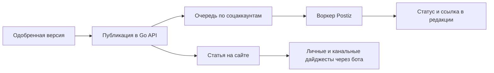

# Creata News — проверка пайплайна и схема публикации через Postiz

Это исходный аудит до исправлений. Действующая схема, настройка Postiz и результат повторного прогона собраны в [руководстве по пайплайну](PIPELINE.md).

19 ноября 2026 года. Редакционный путь от источника до опубликованной статьи и Telegram-дайджеста прошёл на отдельном PostgreSQL с настоящими Go API, Python-воркером, приложениями редакции и кодом бота. Публичный прогон Playwright завершился с кодом 1. На опубликованном домене главная вернула HTTP 200 и показала баннер деморежима. [Публичное демо](https://creata-news-demo.vercel.app/ru)

## Какие этапы прошли

| Этап | Наблюдение |
|---|---|
| Сбор | В режиме проверки источника Hermes прочитал из реальной ленты BBC Technology 21 материал, отброшено 0. При обращении к ленте NASA JPL источник вернул HTTP 403. Сквозной редакционный сценарий использовал отдельную локальную RSS-ленту. |
| Hermes → редакция | Воркер собрал материал, выполнил классификацию, исследование, подготовку текста и проверку. Черновик оставался приватным до одобрения. Отдельные сценарии проверили график с числовым обоснованием и восстановление после ответа модели HTTP 503. Ответы модели задавал тестовый HTTP-сервис. |
| Редакция → сайт | Редактор в браузере создал текст на RU, ҚАЗ и EN, сохранил, одобрил и опубликовал одну версию, затем снял её с публикации. В сценарии Hermes опубликованная статья стала доступна через публичный API и вошла в персональный дайджест. Плановую публикацию проверил серверный тест. |
| Telegram | Код бота прошёл регистрацию, паузу, возобновление и личный дайджест. Для выпуска канала проверены одобрение, постановка в очередь, ответ 429, повторная отправка и отсутствие дубля после подтверждения. Запросы принимал локальный HTTP-сервис Telegram. |
| Аналитика | Редакция показала длительность этапов и воронку. В отдельном браузерном сценарии рейтинг был пуст на новой базе, затем прочитанная статья появилась в публичном рейтинге. |

### Результаты проверок

| Набор | Результат |
|---|---|
| Контракт API, TypeScript и сборка workspace | Прошли |
| Bun | 58 тестов приложения и 1 тест выбора портов прошли |
| Go с PostgreSQL | 67 тестов прошли |
| Python | 33 обычных теста и 3 сквозных теста с Go API прошли |
| Браузер редакции и Hermes | 9 из 9 прошли отдельным запуском на чистой схеме |
| Публичный браузерный набор | 27 прошли, 5 упали, 29 пропущены штатной конфигурацией |

Два падения относятся к блоку «Популярное» при пустой истории просмотров. Оба теста прошли при повторе после чтения статей. Ещё три проверки ищут прежние селекторы навигации и футера либо пытаются выбрать одну из двух ссылок «Газета» без указания меню. В отдельном тесте вариантов главной мобильная навигация и смена языка прошли, а сценарий с жёстко заданным заголовком Ucode упал на другом первом материале. Для воспроизводимого CI нужны данные о просмотрах в тестах карусели, заголовок из публичного API и селекторы по текущим элементам интерфейса.

Дополнительно проверены действия читателя на чистой схеме. Ссылка из заголовка открыла нужную статью. Через меню открылся архив газеты, а из архива — выпуск №01 с 36 полосами. Браузер нашёл фирменный футер на главной, в казахском профиле и на английской странице «О нас».

Рабочий адрес PostgreSQL из локальной конфигурации на порту 54328 не отвечал. Сохранённое окружение Hermes ссылалось на удалённую установку Python. Для аудита использовались временный PostgreSQL 16 на loopback и доступный Python 3.12.14. Боевые AI-вызовы, сбор из Telegram через пользовательскую сессию и доставка в настоящие соцаккаунты остаются непроверенными. Токен бота, канал и данные Telegram-коллектора в локальном окружении пусты.

## Как подключить Postiz

Предлагаемая точка подключения — фактическая публикация редактором или планировщиком. В обоих случаях Go API записывает снимок версии через функцию `publish`. Здесь же можно атомарно добавить задание для каждого выбранного соцаккаунта. Импорт демонстрационных материалов тоже вызывает эту функцию, поэтому источник события должен явно разрешать внешнюю доставку только для редакционной публикации.

1. **Редактор выбирает аудиторию.** В форме публикации показываем подключённые аккаунты, язык и предпросмотр каждого поста. Для текстовых каналов используем заголовок, короткий анонс и ссылку на опубликованную статью. Для Instagram готовим подходящее изображение или видео, для YouTube — видео. Площадка без подходящего медиа получает отдельный статус. [Аккаунты Postiz](https://docs.postiz.com/public-api/integrations/list) · [Настройки Instagram](https://docs.postiz.com/public-api/providers/instagram) · [Настройки YouTube](https://docs.postiz.com/public-api/providers/youtube)
2. **Сайт публикует, воркер доставляет.** Запись версии на сайте и задания в PostgreSQL фиксируем одной транзакцией. Для отложенной статьи задания становятся доступны в момент фактической публикации. Отправку выполняем после фиксации транзакции. Воркер хранит серверный ключ Postiz и создаёт пост по выбранному `integration.id`. Для пилота используем режим `draft`, затем включаем `now` на согласованных аккаунтах. [Создание постов](https://docs.postiz.com/public-api/posts/create)
3. **У каждого аккаунта свой результат.** Ключ задания состоит из статьи, опубликованной версии, аккаунта и языка. В редакции различаем очередь, приём Postiz, подтверждённую публикацию и ошибку. Сохраняем `postId`, затем сверяем состояние и публичную ссылку. После неоднозначного таймаута требуется сверка перед повтором. Сбой отдельной площадки оставляет сайт и другие доставки доступными. [Статусы и ссылки Postiz](https://docs.postiz.com/public-api/posts/list)
4. **Правки и Telegram.** Для повторной публикации исправленной версии редактор отдельно выбирает, нужен ли новый анонс. При снятии статьи отменяем ожидающие задания и показываем уже выпущенные посты редактору. Личные Telegram-дайджесты обслуживает существующий бот. Для каждого публичного Telegram-канала и типа рассылки выбираем одного отправителя, чтобы подписчики не получили один и тот же анонс дважды.

Критерий пилота — один одобренный материал открывается по постоянной публичной ссылке, выбранные аккаунты получают по одному согласованному посту, а редактор видит итог каждого канала. Перед пилотом нужен рабочий публичный сайт с постоянным backend, доступы к выбранным аккаунтам и проверка подготовки медиа.
