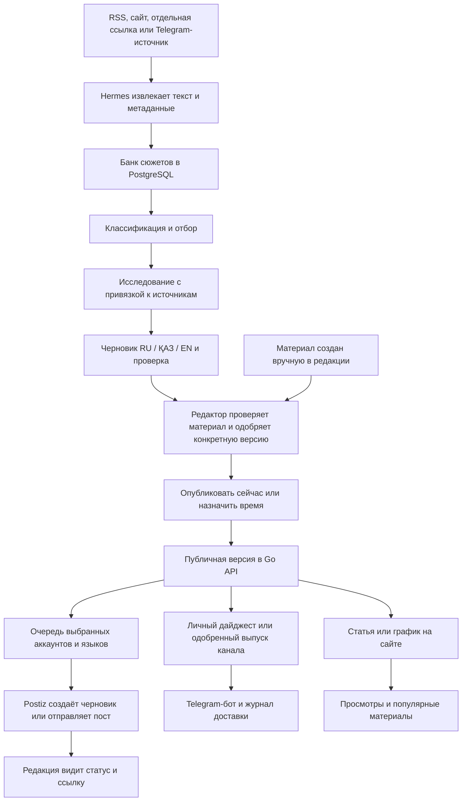

# Как работает Creata News

Редактор управляет выпуском из Creata. Одна одобренная версия статьи или графика может выйти на сайте и получить отдельные анонсы в нескольких соцсетях. Postiz отвечает за эти анонсы. Персональные подборки и выпуски Telegram-канала доставляет существующий бот.

## От источника до читателя



| Этап | Что происходит | Где проверить |
|---|---|---|
| Сбор | Hermes получает задание из Go API, читает источник, извлекает текст, дату и канонический URL. Банк учитывает повторы. Для Telegram-источников нужна сессия коллектора. | Hermes → источники и задания, редакция → банк |
| Подготовка | Воркер классифицирует сюжет, собирает подтверждения, готовит три языковые версии и проверяет черновик. Оплачиваемые этапы резервируют бюджет и сохраняют промежуточные результаты для восстановления. | Настройки AI и задания Hermes, исследовательская справка в карточке |
| Редактура | Редактор проверяет источники, рубрику, автора, текст и права на медиа. Для графика дополнительно проверяются данные. Сохранение новой версии снимает прежнее одобрение. | Карточка статьи или графика, история версий |
| Сайт | При немедленном выпуске Go API сохраняет публичный снимок в транзакции. При отложенном выпуске это делает планировщик по наступлении срока. До следующей публикации читатели видят последнюю выпущенную версию. | `/{язык}/articles/{slug}` или `/{язык}/charts/{slug}` |
| Соцсети | В той же базе хранится задание для каждой выбранной пары «аккаунт + язык». После выхода версии отдельный воркер Go API передаёт задания Postiz и проверяет результаты. | Раздел «Публикации в соцсетях» карточки материала |
| Telegram и аналитика | Бот собирает персональные подборки по предпочтениям читателя. Канальный дайджест редактор отдельно одобряет и ставит в очередь. Сайт регистрирует просмотры, из которых строится рейтинг. | Редакция → дайджесты, журнал доставок и аналитика |

### Другие редакционные материалы

- **График.** Редактор может запросить черновик из банка сюжетов или импортировать данные. Перед публикацией он проверяет значения и источники. На сайте у графика собственная ссылка, которую Postiz использует в анонсе.
- **Возможность.** У гранта, конкурса или мероприятия есть организатор, срок, условия участия и ссылка для заявки. После одобрения карточка появляется в подборке возможностей. Читатель может сохранить её, переход по ссылке для заявки попадает в аналитику.
- **Газета.** Редакция собирает выпуск, добавляет фотографии и открывает предпросмотр. Публикация сохраняет версию в архиве по адресу `/{язык}/gazeta/{slug}`. Выпуск можно снять через редакцию.
- **Страницы сайта.** Тексты об издании и экосистеме имеют собственный предпросмотр. После публикации текст доступен читателям без пересборки сайта.

## Локальный запуск

Нужны Bun, Go, Python с `venv` и запущенный Docker с Compose. Из корня проекта на новой машине:

```sh
bun install --frozen-lockfile
bun run setup:local
docker compose up -d --wait postgres
bun run dev
```

Для последующих запусков достаточно `bun run dev`. Команда проверяет соединение и поднимает уже созданный контейнер PostgreSQL с исходным томом, если тот остановлен. Она проверяет Python и Telethon до запуска служб. Если базовый Python обновился, управляемое окружение `.runtime/hermes-venv` восстанавливается. Для собственного окружения задайте `CREATA_PYTHON` и установите в него зависимости из `hermes-worker/requirements.txt`.

Фактические адреса записываются в `.runtime/local-ports.json`. На этом компьютере сайт открылся на [localhost:3010/ru](http://localhost:3010/ru), редакция на [localhost:6868](http://localhost:6868), Hermes на [localhost:5174](http://localhost:5174). Работоспособность служб показывают [Go API](http://127.0.0.1:5555/health) и [Telegram-бот](http://127.0.0.1:3031/health/live).

Для автоматического черновика в рабочем Hermes задайте OpenAI-совместимый endpoint, модель, ключ, цены токенов и дневной бюджет. Для реальной рассылки Telegram нужны токен бота и права на канал. Локальные сквозные тесты подставляют контролируемые ответы этих сервисов.

## Как редактор публикует через Postiz

1. Подключите нужные соцаккаунты в своём рабочем пространстве Postiz. В приватном окружении Go API задайте `CREATA_POSTIZ_API_KEY` и перезапустите API. Для Cloud базовый адрес по умолчанию — `https://api.postiz.com/public/v1`. Для своей установки укажите полный адрес Public API в `CREATA_POSTIZ_API_URL`. [Получение списка аккаунтов](https://docs.postiz.com/public-api/integrations/list)
2. Одобрите текущую версию материала. В редакторе статьи или графика выберите **Опубликовать** или **Запланировать**. Отметьте аккаунты, задайте язык каждого поста и проверьте анонс. Предпросмотр использует тот же код, который формирует заголовок, лид и ссылку для отправки. При пустом выборе материал выходит только на сайте.
3. Режим `CREATA_POSTIZ_MODE=draft` создаёт в Postiz черновики. Для автоматической отправки после выпуска материала задайте `now` и перезапустите API. Режим записывается в задание при выборе площадок. Сайт и соцсети работают асинхронно, время появления поста зависит также от конкретной платформы. [Режимы публикации Postiz](https://docs.postiz.com/public-api/posts/create)
4. Откройте **Публикации в соцсетях**. У каждого аккаунта есть версия, язык и результат. Принятие запроса Postiz и фактическая публикация отражаются отдельно. После подтверждения платформы появляется ссылка, если её вернул Postiz. [Состояния и публичные ссылки](https://docs.postiz.com/public-api/posts/list)

| Формат | Какие аккаунты можно выбрать | Что подготовить |
|---|---|---|
| Текст и ссылка | X, LinkedIn и LinkedIn Page, Facebook, Threads, Bluesky, Mastodon, Nostr, VK | Заголовок и лид на языке аккаунта. Система учитывает лимит длины и сохраняет ссылку на опубликованный материал. |
| Фотопост | Instagram и Instagram Standalone | JPEG до 8 МиБ с соотношением сторон от 4:5 до 1,91:1. Выберите файл медиатеки либо используйте подходящее медиа статьи. |
| Видео | YouTube | Выберите MP4 из медиатеки и доступ к видео. По умолчанию установлен приватный доступ. Для новой загрузки через медиатеку действует лимит 10 МиБ. |
| Telegram | Дайджесты обслуживает бот Creata | В редакции одобрите выпуск канала. Аккаунт Telegram в списке Postiz помечен недоступным, чтобы исключить вторую отправку тем же маршрутом. |

Для Instagram и YouTube нужны проверенные права в медиатеке и доступный извне HTTPS-адрес файла. Сервер проверяет медиа до отправки. Недостаток медиа виден по конкретному аккаунту, остальные выбранные площадки продолжают обработку. [Загрузка медиа в Postiz](https://docs.postiz.com/public-api/uploads/upload-from-url)

### Повторы, исправления и снятие публикации

- Уникальная запись связывает материал, опубликованную версию, аккаунт и язык. Повторная обработка той же доставки использует эту запись. При исправлении редактор одобряет новую версию и заново выбирает аккаунты.
- При ограничении частоты воркер откладывает повтор. Если соединение прервалось после передачи запроса, воркер сверяет запись с календарём Postiz. Статус «Проверьте результат в Postiz» означает, что исход пока неизвестен.
- При снятии статьи ожидающие задания отменяются. Уже созданные посты остаются видны в истории. Если требуется отозвать пост в соцсети, редактор проверяет его в Postiz или на самой платформе.

## Как повторить сквозную проверку

```sh
bun run setup:local --test-db
bun run test:pipeline
```

Для стандартного Compose первая команда готовит отдельную `creata_test`. Если используете свой PostgreSQL, создайте отдельную тестовую базу, укажите её в `CREATA_TEST_DATABASE_URL` и запустите вторую команду. Для первого запуска браузерных сценариев установите Chromium командой `bunx playwright install chromium --only-shell`. Прогон также распознаёт проектный кеш `.runtime/browsers` и учитывает явные `PLAYWRIGHT_BROWSERS_PATH` и `CREATA_BROWSER_EXECUTABLE`.

Прогон создаёт временную схему и отдельный API, загружает тестовые материалы, запускает Hermes, проверяет Telegram, собирает публичный сайт и открывает его и обе админки в Chromium. Запросы к Postiz принимает локальный HTTP-сервис. В него должны прийти ровно два черновика — казахский анонс материала из Hermes и английский анонс статьи, опубликованной редактором через браузер. Проверяются текст, аккаунт, язык ссылки, статус и отсутствие дублей. После завершения скрипт останавливает тестовые сервисы и удаляет временную схему.

Дополнительно `bun run test` проверяет приложения и общие библиотеки, `bun run test:hermes` — Python-воркер, `bun run typecheck` — типы, `bun scripts/generate-contracts.ts --check` — актуальность контракта. Серверные тесты запускаются командой `go test ./...` в `backend/creata` с переменной `CREATA_TEST_DATABASE_URL` в окружении процесса.

## Результат проверки 19 ноября 2026 года

| Что проверено | Результат на локальном стенде |
|---|---|
| Рабочий запуск | PostgreSQL запущен с исходным томом. После проверки в рабочей базе осталось 16 статей и 8 публичных версий. Сайт, редакция, Hermes, API и бот ответили HTTP 200. В отдельной базе `creata_test` после прогона не осталось временных схем сквозной проверки. |
| Hermes и Telegram | 33 модульные проверки Python и 3 сценария с работающим API прошли. Бот прошёл регистрацию, паузу, возобновление, личный и канальный дайджесты. После ответа 429 повторная попытка завершилась одной подтверждённой доставкой. |
| Сайт и админки | 34 сценария сайта и 9 сценариев редакции и Hermes прошли в Chromium, в том числе все пять ранее падавших. Ещё 27 сценариев относятся к отдельным демосборкам и визуальным превью и пропущены в этом режиме. |
| Postiz | Локальный HTTP-стенд принял два черновика на один тестовый аккаунт Threads. Один материал прошёл через Hermes, второй редактор создал в браузере. Дубли отсутствовали. Настоящие соцаккаунты в прогоне не использовались. |
| Код и сборка | 72 серверных теста с PostgreSQL прошли на Windows и повторно в Linux с `go test -race`. Прошли 58 тестов приложений на Bun и тест выбора портов. Проверены типы, контракт API и сборки для публикации сайта на Next.js 16.4.6, обеих админок и бота. |
