# Creata News — техническая архитектура и UML

Срез реализации на **24 ноября 2026 года**. Описание основано на текущем рабочем дереве, включая локальные изменения поверх коммита `170ac2f`. Диаграммы встроены в этот Markdown в формате Mermaid, который отображает схемы в GitHub и совместимых редакторах. Последовательности, состояния и модель классов используют соответствующие типы Mermaid. Варианты использования, компоненты, развёртывание и процессы показаны блок-схемами с подписями. Результаты локальной проверки относятся к описанному рабочему дереву.

## Содержание

1. [Что сделали](#что-сделали)
2. [Технологии и структура проекта](#технологии-и-структура-проекта)
3. [Компоненты, роли и развёртывание](#компоненты-роли-и-развёртывание)
4. [Данные и доменная модель](#данные-и-доменная-модель)
5. [Hermes и редакционная работа](#hermes-и-редакционная-работа)
6. [Публичный сайт и функции читателя](#публичный-сайт-и-функции-читателя)
7. [Газета, графики, CMS и медиа](#газета-графики-cms-и-медиа)
8. [Доставка в Postiz и Telegram](#доставка-в-postiz-и-telegram)
9. [API, авторизация и эксплуатация](#api-авторизация-и-эксплуатация)
10. [Как проверять проект](#как-проверять-проект)
11. [Текущие технические границы](#текущие-технические-границы)

## Что сделали

Creata News — трёхъязычная редакционная платформа на русском, казахском и английском. Мы связали сбор материалов, подготовку черновиков, редактуру, публикацию, архив и доставку в один процесс. Читатель открывает опубликованную версию. Редакция в это время может готовить следующую версию той же статьи. Выбрав конкретную ревизию, редактор может выпустить её сразу или назначить время публикации.

| Часть | Что работает |
| --- | --- |
| Публичный сайт | Два варианта главной, свежие новости, рубрики, регионы, мировой раздел, экосистема Creata, авторы, поиск, популярное, профиль, сохранённые материалы и подписки на развитие сюжетов. |
| Редакция | Банк материалов, ручной сбор по ссылке, сравнение и объединение похожих историй, канбан, редактор с предпросмотром, правки и сравнение ревизий, утверждение и выпуск, календарь продолжений, команда, аудит и аналитика. |
| Hermes | Панель источников, заданий, запусков и ошибок. Фоновый воркер читает RSS, сайты и публичные Telegram-каналы, классифицирует находки, собирает подтверждения, готовит текст в трёх локалях и возвращает замечания для редактора. |
| Другие форматы и каталоги | Цифровая газета с архивом, графики на проверенных данных, редактируемые страницы сайта, медиатека с правами и авторством, каталог возможностей и каталог запусков с подачей от основателей. |
| Распространение | Postiz для выбранных социальных аккаунтов и локалей. Telegram-бот для одобренных канальных выпусков и персональных подборок при включённом режиме. |
| Изолированное демо | Тот же публичный интерфейс и две админки. Сценарии публикации и рассылки воспроизводятся на тестовом контенте со своими данными в каждом браузере. |

[Обзор проекта](../README.md) · [Редакционный процесс](PIPELINE.md) · [Демо](DEMO-VERCEL.md)

## Технологии и структура проекта

| Каталог | Технологии | Ответственность |
| --- | --- | --- |
| [creatanews](../creatanews/package.json) | Next.js **16.4.6** с App Router, React **19**, TypeScript **5.9**, CSS/CSS Modules, Embla, Motion, Lucide | Публичные маршруты, серверный рендеринг, метаданные, интерактивное чтение и прокси API. |
| [events-admin](../events-admin/package.json) | React **19**, Vite **6**, TanStack Router и Query, Base UI, Tailwind CSS **4** | Панель редакции и общие компоненты двух админок. Router ведёт по разделам, Query управляет запросами и обновляет данные после изменений. |
| [agent-admin](../agent-admin/src/main.tsx) | Тот же Vite/React-стек, отдельная точка входа | Запускает общий `AdminApp` с `mode='hermes'`. У приложения свой адрес, разделы и сборка. |
| [backend/creata](../backend/creata/go.mod) | Go **1.26**, стандартный `net/http` и `ServeMux`, pgx **5.9.2**, PostgreSQL **16** в Compose | Единый HTTP API, проверка прав и данных, транзакции, планировщик, outbox Postiz, JSONB и SQL. |
| [hermes-worker](../hermes-worker/Dockerfile) | Python **3.13** в контейнере и CI, стандартная библиотека, Telethon **1.45.0** | Сбор, разбор RSS/HTML, Telegram MTProto, подготовка задач AI и восстановление оплаченных результатов. |
| [telegram-bot](../telegram-bot/package.json) | Bun, TypeScript, grammY | Telegram Bot API, команды читателя, обработка webhook или polling и передача подтверждений доставки в Go. |
| [packages](../packages) | Bun workspaces, TypeScript, React | `@creata/contracts` — типы, общий HTTP-клиент и разбор контента статьи. `@creata/brand` — бренд, логотип и шрифты. `@creata/graphics` — модель, проверки и SVG-компонент графиков. `@creata/demo-pipeline` — браузерная модель демо. |
| [scripts](../scripts) и [CI](../.github/workflows/ci.yml) | Bun **1.4.2** закреплён для CI и образов, Docker Compose, Nginx, Playwright **1.58.2**, GitHub Actions | Запуск, проверка и сборка стека, генерация контрактов, сквозные тесты и упаковка демо. |

Версии указаны по манифестам и конфигурации. Backend — модуль `backend/creata` с точкой входа `cmd/server`. Compose собирает этот модуль и бота из `telegram-bot/src/creata`. Публичный сайт и админки используют общие компоненты оформления. [Манифест монорепозитория](../package.json) · [Compose](../compose.yaml) · [Границы реализации](IMPLEMENTATION.md)

## Компоненты, роли и развёртывание

### 1. Компоненты и внешние системы

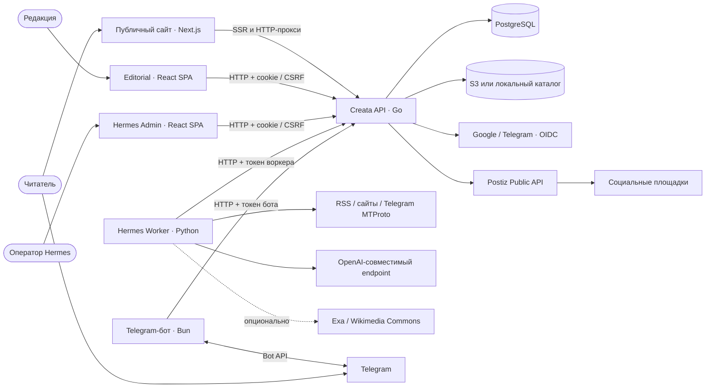

Go — центральный владелец состояния. Сайт читает опубликованные данные. Панели отправляют команды в API. Python и бот получают работу через HTTP. В процессе Go отдельно крутятся планировщик и отправитель Postiz. HTTP к внешним провайдерам выполняется независимо от выдачи публичной страницы. [Точка входа Go](../backend/creata/cmd/server/main.go) · [Конфигурация](../compose.yaml)

### 2. Варианты использования и роли

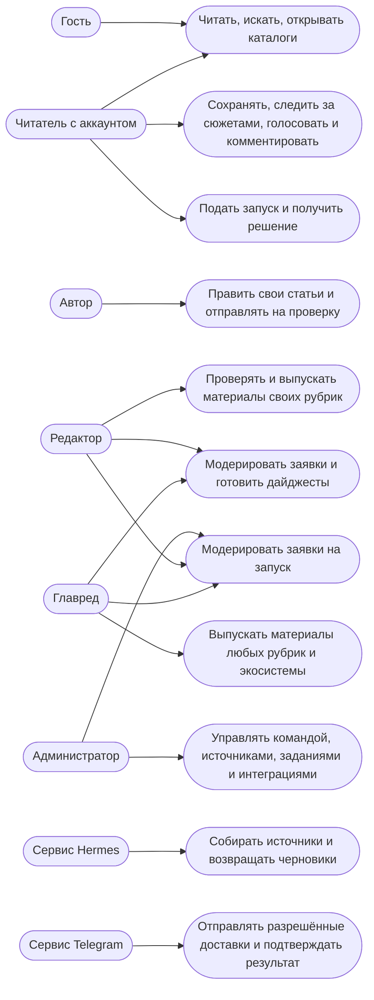

Один пользователь может иметь несколько ролей. Go проверяет и роль, и конкретный объект. `author` редактирует свои статьи, `editor` работает со статьями назначенных рубрик и выпускает материалы `world`. Для статей слоя `eco` нужен `chief_editor`. Техническая роль `admin` управляет системой и имеет права в отдельных модулях, например в газете и CMS. Для публикации статьи права вычисляются через `canPublish`. [Проверки доступа](../backend/creata/internal/news/domain.go) · [Редакционный API](../backend/creata/internal/news/editorial.go) · [Заявки](../backend/creata/internal/news/launch_submissions.go)

### 3. Развёртывание полного стека

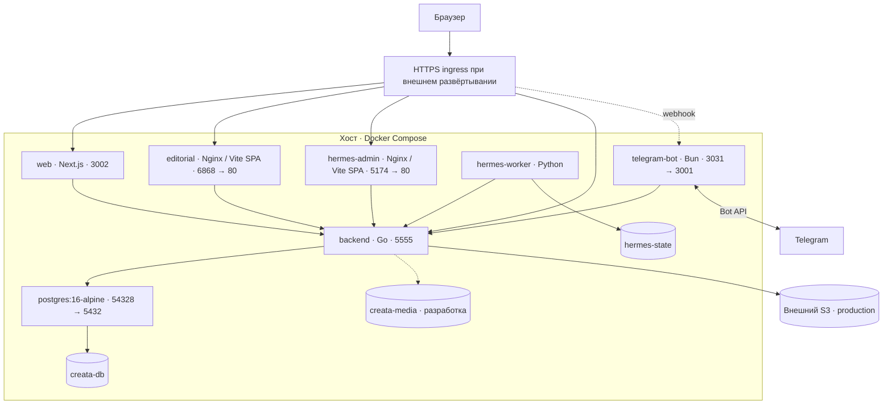

Порты на схеме — значения по умолчанию. Compose привязывает опубликованные порты к `127.0.0.1`. В нативном dev-режиме Bun запускает процессы напрямую и записывает фактические адреса в `.runtime/local-ports.json`. В контейнерах статические админки обслуживает Nginx, а Next запускается из standalone-сборки. Публичный HTTPS ingress устанавливается отдельно. [Compose](../compose.yaml) · [Локальный запуск](../scripts/dev-local.ts) · [Nginx редакции](../events-admin/nginx.conf) · [Образ Next](../creatanews/Dockerfile)

### 4. Развёртывание браузерного демо

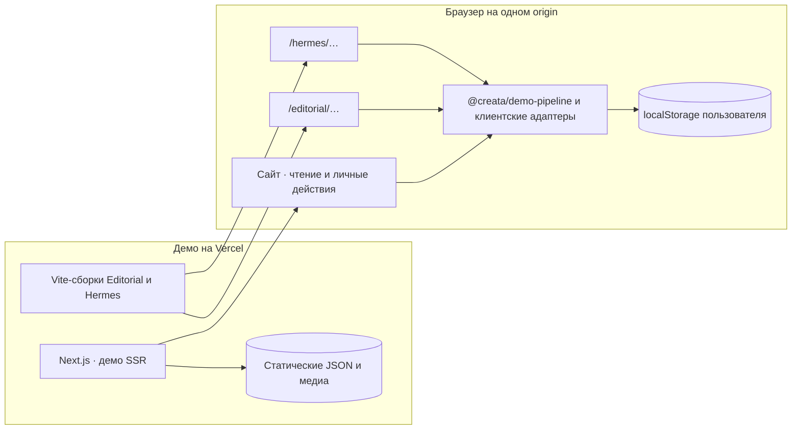

Демо включается явным флагом `NEXT_PUBLIC_CREATA_DEMO_MODE=1`. Серверная начальная выдача читает статические фикстуры. После загрузки браузер показывает локальные изменения через адаптеры. На одном origin сайт и админки видят опубликованные демоверсии в общем браузерном хранилище. Настройки читателя также лежат локально. OAuth, реальные сбор, AI и рассылка отключены. Обычная сборка при недоступном API возвращает ошибку. [Демо-сборка](DEMO-VERCEL.md) · [Маршрутизация Next](../creatanews/next.config.ts) · [Демо-адаптер](../packages/demo-pipeline/src/index.ts)

## Данные и доменная модель

### 5. Логическая UML-модель

На схеме показаны основные поля и связи бизнес-сущностей. `Story` в банке Hermes — собранный кандидат. Хронология на сайте принадлежит опубликованной версии `Article` и состоит из `StoryUpdate`. Пользователь редакции и публичная карточка автора хранятся как разные сущности.

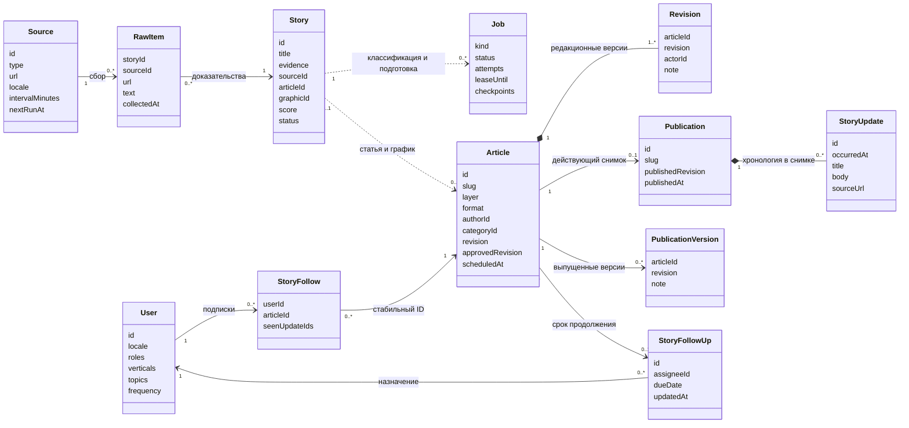

Связь статьи с публичной карточкой автора идёт через `authorId`, с рубрикой через `categoryId`. Внутри статьи также хранятся ссылки на источники, `actionGuide`, `photos`, `opportunityIds` и для формата `graphic` данные графика. Заявка на запуск принадлежит основателю и при выпуске создаёт запись каталога с тем же ID. Газетный номер хранит собственный снимок материалов. Дайджест содержит выбранные статьи и возможности, а доставка хранит адресата, снимок сообщения и исход отправки. [Схемы предметной области](../backend/creata/openapi.json) · [Ревизии](../backend/creata/internal/news/editorial.go) · [Подписки](../backend/creata/internal/news/followed_stories.go) · [Газета](../backend/creata/internal/news/newspaper.go)

### 6. Логические связи каталогов, выпусков и доставок

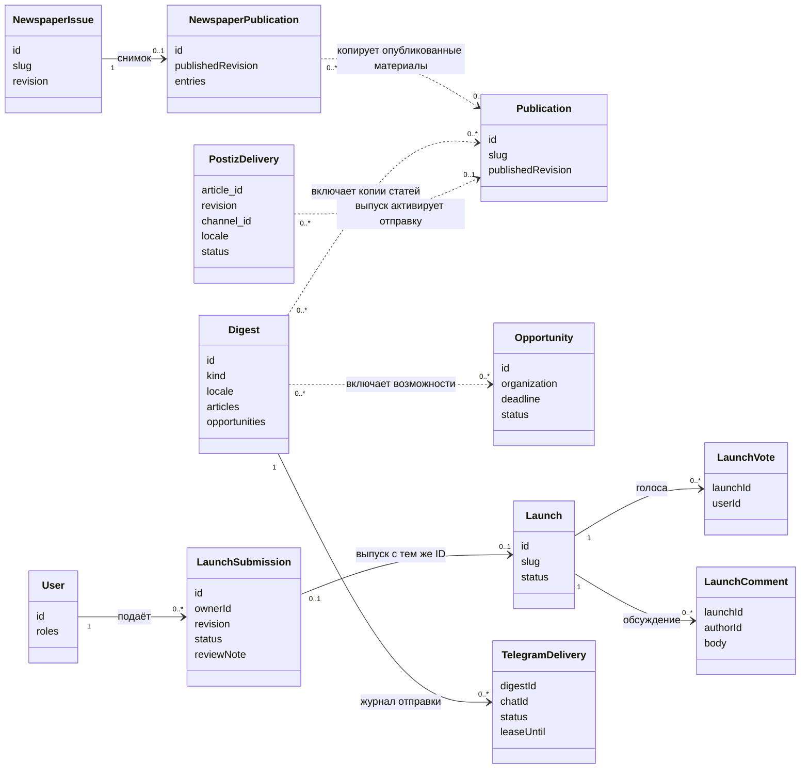

У последней связи ключ отправки включает редакционную ревизию, и запись может остаться в журнале после замены или снятия снимка. `PostizDelivery` здесь показана с именами SQL-колонок. Telegram-доставка использует документ `delivery`. [Каталог запусков](../backend/creata/internal/news/launch.go) · [Газетные снимки](../backend/creata/internal/news/newspaper.go) · [Дайджесты](../backend/creata/internal/news/digests.go) · [Структура Postiz](../backend/creata/internal/news/schema.sql)

### 7. Физическая схема PostgreSQL

Физически это **9 таблиц**. В `creata_records` документ находится по составному ключу `(kind, id)`, а поля хранятся в `data JSONB`. Стрелки на диаграмме показывают логические ссылки по ID и работу триггера. Целостность этих связей контролирует приложение.

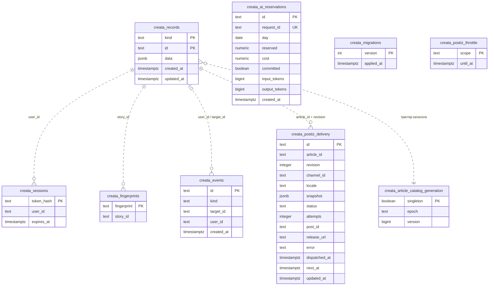

| Область | Ключевые значения `creata_records.kind` |
| --- | --- |
| Контент и справочники | `article`, `revision`, `publication`, `publication_version`, `author`, `category`, `opportunity`. |
| Hermes | `source`, `raw_item`, `story`, `story_merge`, `job`, `settings`. |
| Аккаунты и взаимодействия | `user`, `identity`, `oauth`, `telegram_link`, `save`, `story_follow`, `story_follow_up`. |
| Запуски | `launch_submission`, `launch`, `launch_vote`, `launch_comment`. |
| CMS, газета, файлы | `site_page`, `site_page_revision`, `site_page_publication`, `newspaper_issue`, `newspaper_publication`, `media`, `media_cleanup`, `media_tombstone`. |
| Доставка и аудит | `digest`, `delivery`, `digest_period`, `sent_item`, `audit`. |

SQL вшит в Go-бинарник и применяется при открытии базы. `Store.Write` использует транзакционную advisory lock для сериализации защищённых операций. Для очереди Postiz есть отдельный SQL claim через `FOR UPDATE SKIP LOCKED`. PostgreSQL дополнительно применяет частичные индексы по типам документов, уникальные индексы для отдельных ключей и GIN по `data`. Версия каталога обновляется триггером при записи публикаций, истории выпусков и авторов. [DDL](../backend/creata/internal/news/schema.sql) · [Триггер каталога](../backend/creata/internal/news/public_catalog_cache.sql) · [Store](../backend/creata/internal/news/store.go) · [Postiz worker](../backend/creata/internal/news/postiz_worker.go)

## Hermes и редакционная работа

### 8. Диаграмма деятельности от источника до читателя

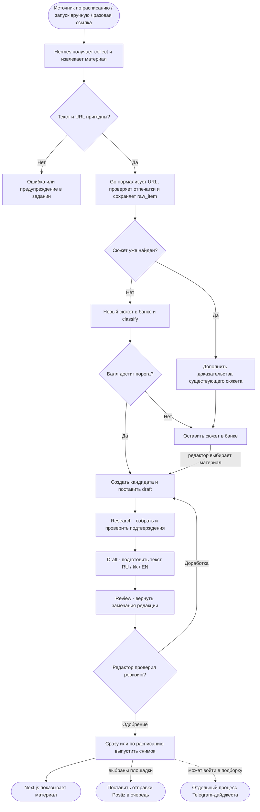

- Типы источников — `rss`, `website`, `telegram`. Проверка источника использует `check`, сбор — `collect`. Разовый URL в банке создаёт неактивный одностраничный источник. Telegram-сборщик использует отдельную MTProto-сессию Telethon и читает настроенные публичные каналы.
- Go канонизирует URL, удаляет параметры отслеживания, проверяет отпечатки материала, хранит оригиналы в `raw_item` и доказательства в сюжете. Банк умеет сравнивать близкие сюжеты, объединять их и разбирать объединения с сохранением происхождения.
- `classify` возвращает рубрику, регион, теги, балл, обоснование и при наличии структурированные факты и сущности. Порог по умолчанию — 75, он настраивается. Редактор также может вручную запустить черновик статьи или графика.
- Для текста Hermes готовит `research → draft → review`. Исследование строится на извлечённых текстах, цитатах и доступных адресах. AI получает ограниченный контекст проверенных возможностей. Дополнительная проверка проекта сопоставляет заявленные даты и числа с цитатами. При единственном читаемом источнике и настроенном ключе Exa может искать дополнительные материалы. Hermes повторно читает найденные страницы и проверяет релевантность.
- Hermes может предложить фотографии Wikimedia Commons для подходящего сюжета. В карточку попадают сведения об авторе, лицензии и странице файла. Редактор видит фотографии в предпросмотре и может их удалить. HTTP-сбор проверяет адреса целей и переадресаций, ограничивает объём и учитывает `robots.txt`.

[Сборщики](../hermes-worker/hermes/collectors.py) · [Нормализация и задания](../backend/creata/internal/news/jobs.go) · [Банк](../backend/creata/internal/news/bank_merge.go) · [AI-конвейер](../hermes-worker/hermes/pipeline.py) · [Exa](../hermes-worker/hermes/exa.py) · [Фото](../hermes-worker/hermes/photos.py)

### 9. Последовательность выполнения AI-задания

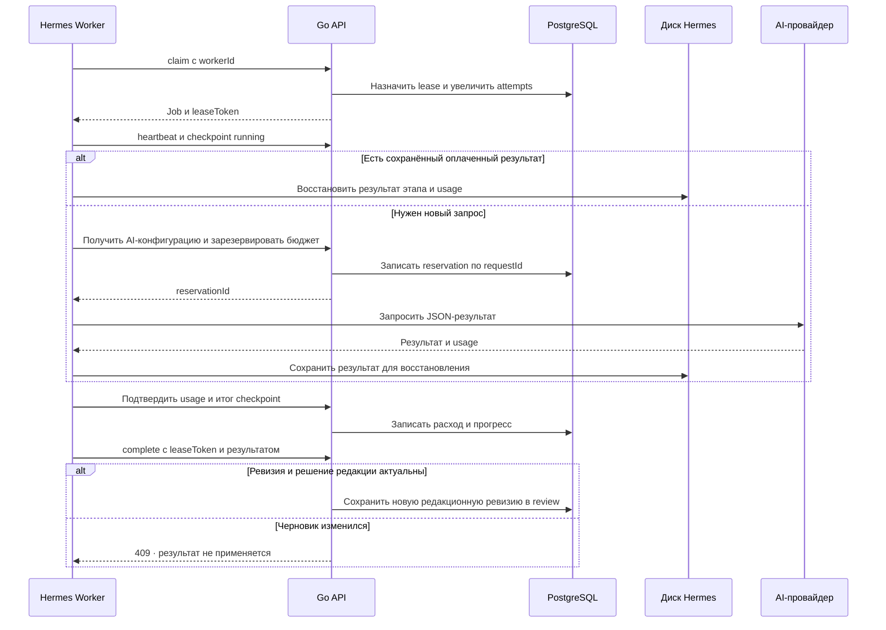

Диаграмма показывает оплачиваемый этап и завершение `draft/rework`. API атомарно резервирует лимит до обращения к модели, затем учитывает фактические токены. Сумма открытых резервов учитывается в дневном бюджете по дате PostgreSQL. Python синхронизирует свой файловый outbox с Go, чтобы восстановить полученный платный результат после сбоя записи. AI endpoint, модель, ключ, цены токенов и положительный бюджет задаются в настройках. Без них обычный сбор и ручная редактура доступны, а задания с AI фиксируют `not_configured`. [Бюджет](../backend/creata/internal/news/jobs.go) · [Чекпоинты](../backend/creata/internal/news/pipeline.go) · [Вызов AI](../hermes-worker/hermes/ai.py) · [Восстановление расходов](../hermes-worker/hermes/accounting.py)

### 10. Состояния задания Hermes

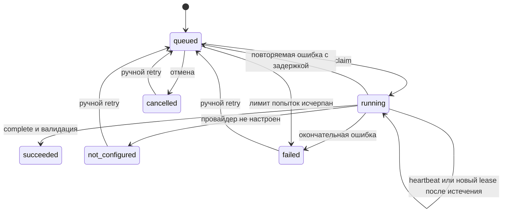

У текущего claim есть срок и токен. Для записи результата API проверяет владение lease. У `draft/rework` результат также привязан к исходной редакционной ревизии и, там где задано, к ID активной AI-задачи. При исчерпании трёх автоматических попыток требуется решение оператора. [Переходы заданий](../backend/creata/internal/news/jobs.go)

### 11. Состояния редакционной статьи

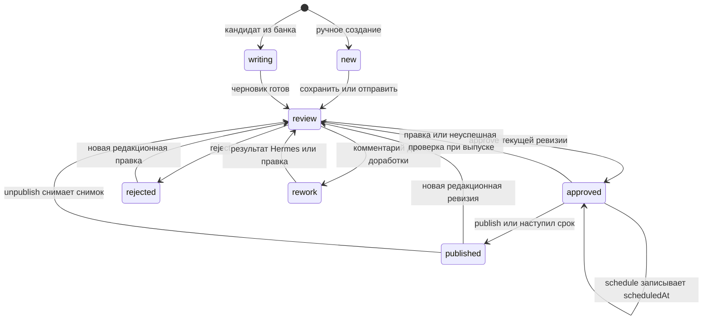

Схема показывает основной редакционный маршрут. `scheduledAt` — поле статьи, а не дополнительное значение `status`. Операции используют `expectedRevision`. При расхождении сервер возвращает `409 Conflict`. Сохранение новой ревизии сбрасывает утверждение. Если уже был выпуск, текущий публичный снимок сохраняется. Снятие публикации удаляет активный снимок и сохраняет редакционную историю. [Редакционные переходы](../backend/creata/internal/news/editorial.go) · [Ревизии и права](../backend/creata/internal/news/domain.go)

### 12. Последовательность выпуска и обновления сайта

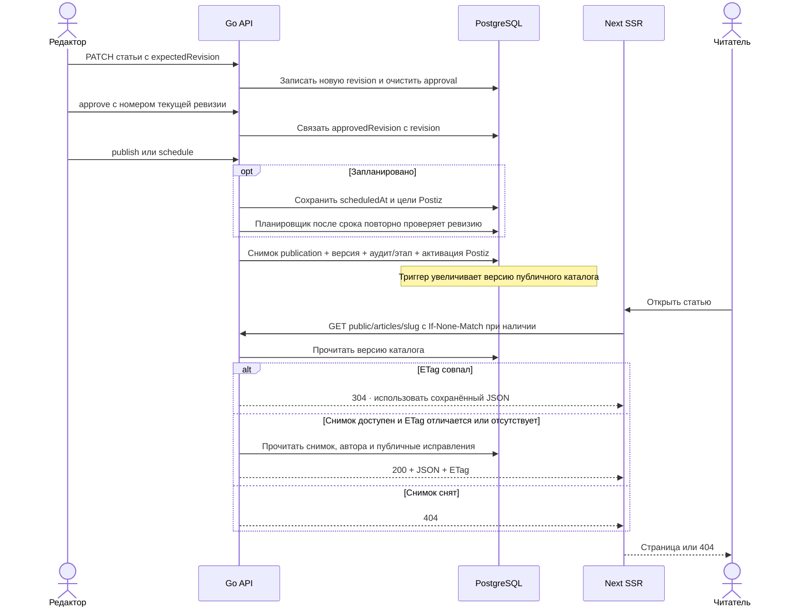

Валидация утверждения требует заголовок и основной текст во всех трёх языках. Дополнительно проверяются ссылки, права на загруженное медиа и требования формата. Публичные исправления берутся из заметок выпущенных версий. Аудит редакционной команды хранит участника и действие. [Проверки перед публикацией](../backend/creata/internal/news/domain.go) · [Планировщик](../backend/creata/internal/news/jobs.go) · [Публичный каталог](../backend/creata/internal/news/public_archive.go)

## Публичный сайт и функции читателя

| Маршруты | Что получает читатель |
| --- | --- |
| `/{locale}`, `/{locale}/v2`, `/{locale}/latest` | Варианты главной, свежая лента, ведущие материалы и блок популярного. |
| `/{locale}/world`, `/ecosystem`, `/categories/{slug}`, `/authors/{id}`, `/search` | Новости по слоям и темам, страницы авторов, выдача по запросу. |
| `/{locale}/articles/{slug}`, `/charts/{slug}` | Локализованная статья или график, источники, иллюстрации с атрибуцией, публичные исправления и хронология, если редакция их добавила. |
| `/{locale}/opportunities/{id}`, `/launches/{slug}` | Возможности с дедлайнами и переходом к организатору, карточки запущенных проектов с обсуждением и голосованием. |
| `/{locale}/gazeta/{issue}`, `/about` | Газетный выпуск и информация о проекте. |
| `/{locale}/profile`, `/saved`, `/following` | Язык, тематики, частота дайджеста и привязка бота, сохранения, подписки на сюжеты, подача и статус запуска. |

После первого пути в каждой строке общий префикс `/{locale}` опущен. Допустимые языки — `ru`, `kk`, `en`. Страницы списка имеют отдельные маршруты для авторов, возможностей, запусков, графиков и архива газеты. Редакционные предпросмотры статьи и газеты обращаются к закрытым данным с активной сессией. [Дерево маршрутов](../creatanews/src/app) · [Локализация](../creatanews/src/lib/i18n.ts)

### Как сайт читает данные

- Публичный SSR идёт напрямую из Next.js в Go. Браузерные операции профиля, сохранений и аналитики идут через `/api/creata/v1` на сайте. Публичные данные действующих статей читаются из `publication`. Карточки авторов подгружаются через `LEFT JOIN`.
- Архив фильтруется в SQL по слою, рубрике, региону, автору и формату. Поиск ищет регистронезависимую подстроку в заголовке и основном тексте выбранной локали. API поддерживает cursor pagination по времени создания записи и ID, пакет от 1 до 100, флаги `translated=1`, `includeTotal=0` и `view=summary`. Краткий ответ содержит расчёт времени чтения без основного текста.
- Список статей, карточка по slug и список регионов поддерживают слабый `ETag`. Next.js держит ограниченный кэш JSON в памяти процесса и проверяет его у Go перед повторным использованием. Общий лимит — 16 МиБ, до 128 записей, максимум 2 МиБ на ответ. Персональные и административные ответы отдаются с `no-store`.
- Блок популярного показывает до шести опубликованных переведённых материалов по числу принятых просмотров за последние семь дней. Сайт передаёт события просмотра, сохранения и перехода к возможности. Редакция получает агрегаты и длительности этапов подготовки материалов.
- Статьи используют canonical, hreflang и Open Graph. В sitemap учитываются доступные переводы и канонический путь графика. Демо закрыто от индексации через `robots.txt`.

[Архив и поиск](../backend/creata/internal/news/public_archive.go) · [Кэш SSR](../creatanews/src/lib/api.ts) · [Популярное](../backend/creata/internal/news/popular.go) · [Аналитика этапов](../backend/creata/internal/news/stage_analytics.go) · [Sitemap](../creatanews/src/app/sitemap.ts)

### 13. Последовательность подписки на развитие сюжета

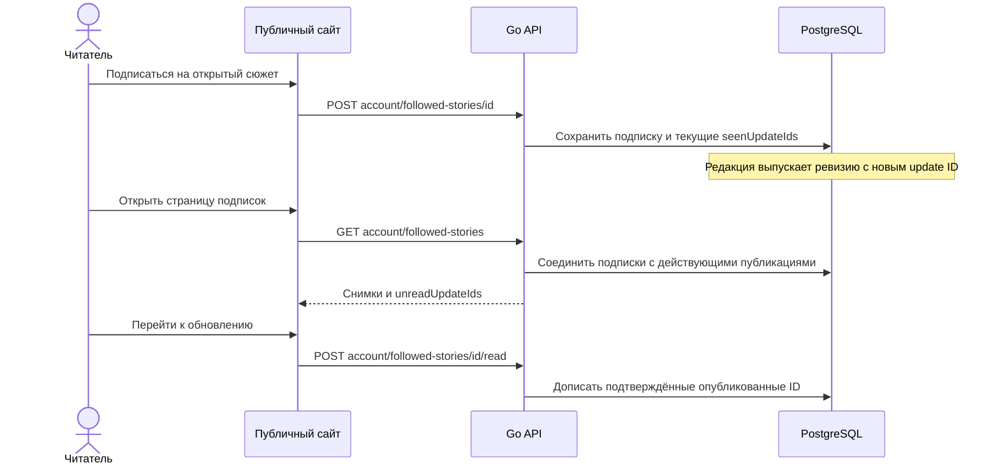

Хронология сортируется по времени события. Подписка привязана к ID статьи, а прочитанность привязана к ID конкретного обновления. В момент подписки уже опубликованные обновления отмечаются прочитанными. После первого выпуска статьи с хронологией её `slug` фиксируется. В редакции есть `story_follow_up` — задание вернуться к сюжету к дате, с ответственным редактором. [Подписки](../backend/creata/internal/news/followed_stories.go) · [Постоянный адрес сюжета](../backend/creata/internal/news/article_extras.go) · [Редакционное продолжение](../backend/creata/internal/news/story_follow_ups.go)

### 14. Состояния заявки на запуск

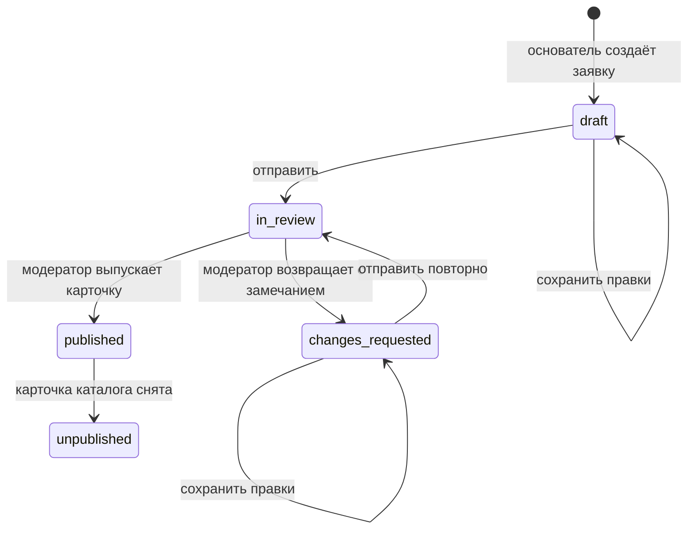

Основатель работает через профиль. Модераторы видят очередь `in_review` и проверяют текущую ревизию. Публикация заявки в транзакции создаёт запись `launch` с общим ID и публичным slug. `unpublished` в списке заявок вычисляется по состоянию карточки каталога. За карточкой сохраняются отдельные записи голосов и комментариев. Голос относится к паре «запуск + пользователь», повтор комментария с тем же клиентским ID возвращает уже созданную запись. У возможностей статусы `pending`, `approved` и `rejected`. Для одобрения проверяются переводы, организация, ссылка, дедлайн и права на фото при наличии. Просроченные предложения исключаются из активной выдачи и дайджестов. [Модерация заявок](../backend/creata/internal/news/launch_submissions.go) · [Голосование и комментарии](../backend/creata/internal/news/launch_social.go) · [Возможности](../backend/creata/internal/news/opportunity.go)

## Газета, графики, CMS и медиа

### 15. Связи редакционных форматов

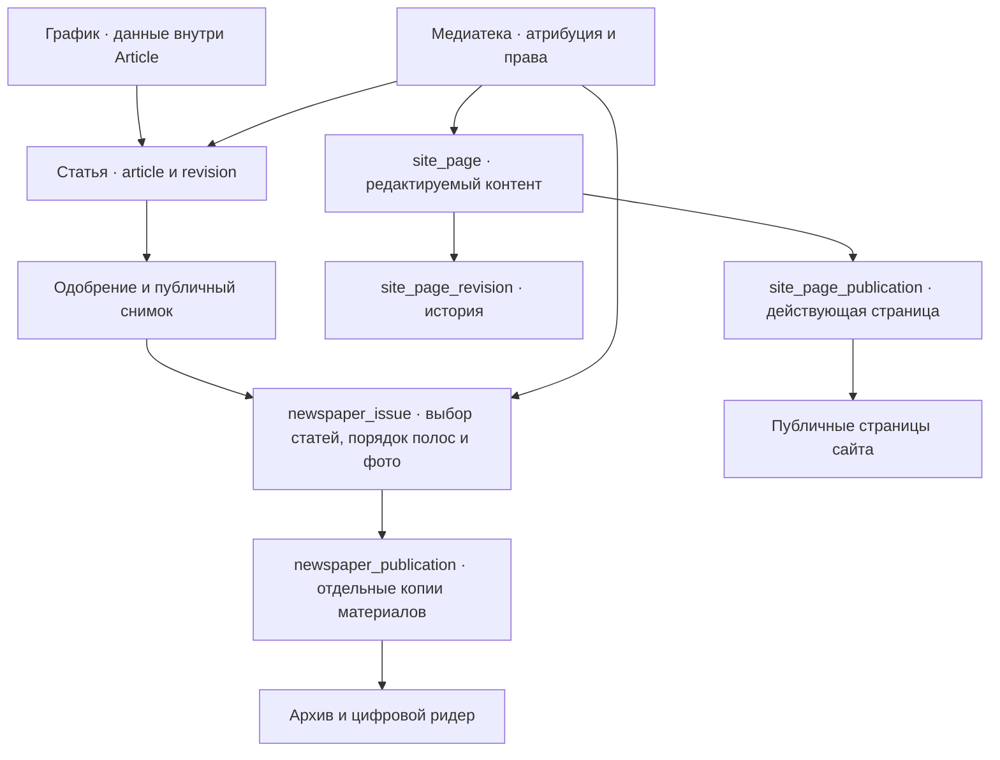

| Подсистема | Как реализована |
| --- | --- |
| Газета | Панель `/newspapers` собирает черновик из опубликованных статей. Настраиваются порядок полос, обложка и замены изображений. Публичный выпуск фиксирует тексты и изображения как отдельный снимок. Исходный №01 импортируется как отдельный выпуск с медиа и PDF. |
| Графики | `format=graphic` расширяет статью через `GraphicData`. Данные проверяются в общем пакете, выводятся в SVG. Редактор сопоставляет значения с источником и отмечает проверку данных. Правка набора сбрасывает подтверждение. Черновик может создать редактор или Hermes. |
| CMS | Контент страниц и исходного выпуска импортируется из `backend/creata/content`. Повторный импорт сохраняет существующие редакционные изменения. Go проверяет структуру, хранит ревизии и отдаёт публичный снимок. |
| Медиатека | Go принимает JPEG, PNG, WebP, GIF и MP4 до 10 МиБ через multipart. Требуются сведения об авторе и правах. Метаданные файла хранятся в PostgreSQL, содержимое в S3-совместимом хранилище или локальном каталоге разработки. Удаление учитывает ссылки из действующего контента и ожидающих доставок. Для исторических медиа сохраняются переадресации. |

[Газета](NEWSPAPER.md) · [Графики](CHARTS.md) · [CMS и импорт](../backend/creata/internal/news/content.go) · [Медиатека](../backend/creata/internal/news/media_library.go)

## Доставка в Postiz и Telegram

### 16. Последовательность отправки в Postiz

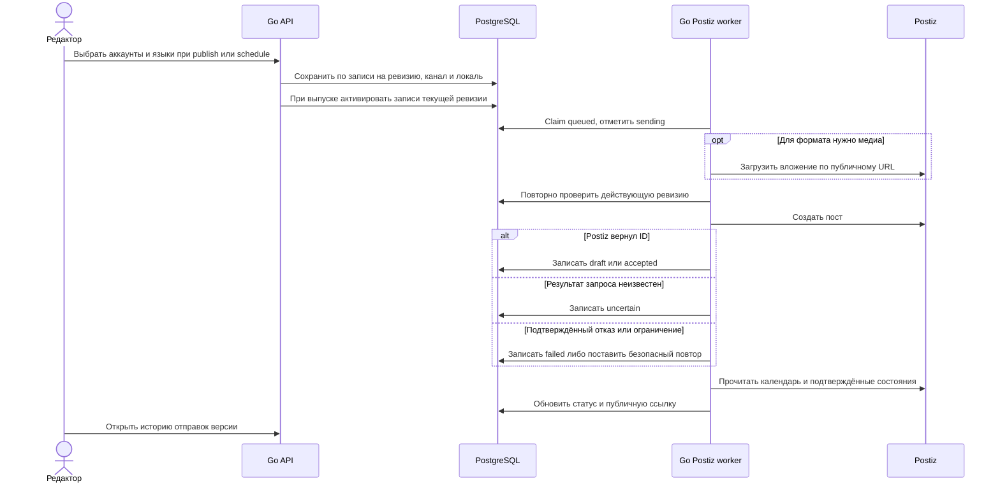

Вместе с версией материала фиксируются текст анонса, аккаунт, язык, ссылка, режим и требования к медиа. `draft` создаёт черновик, `now` передаёт материал на публикацию после выпуска сайта. Внешние состояния включают `accepted`, `published` и `failed`, локальные также `scheduled`, `queued`, `sending`, `uncertain`, `cancelled` и `missing_media`. `accepted` означает, что Postiz принял запрос. Факт выхода подтверждается состоянием `published`. При неопределённом исходе воркер сверяет календарь, чтобы избежать дублей. При снятии статьи ещё не отправленные задания могут отменяться. Уже вышедшие внешние посты остаются внешними публикациями. Telegram как площадку Postiz приложение помечает недоступной. Канал обслуживает отдельный бот. [Настройка и форматы Postiz](PIPELINE.md#как-редактор-публикует-через-postiz) · [Outbox](../backend/creata/internal/news/postiz_outbox.go) · [Обработка результатов](../backend/creata/internal/news/postiz_worker.go)

### 17. Состояния отправки Postiz

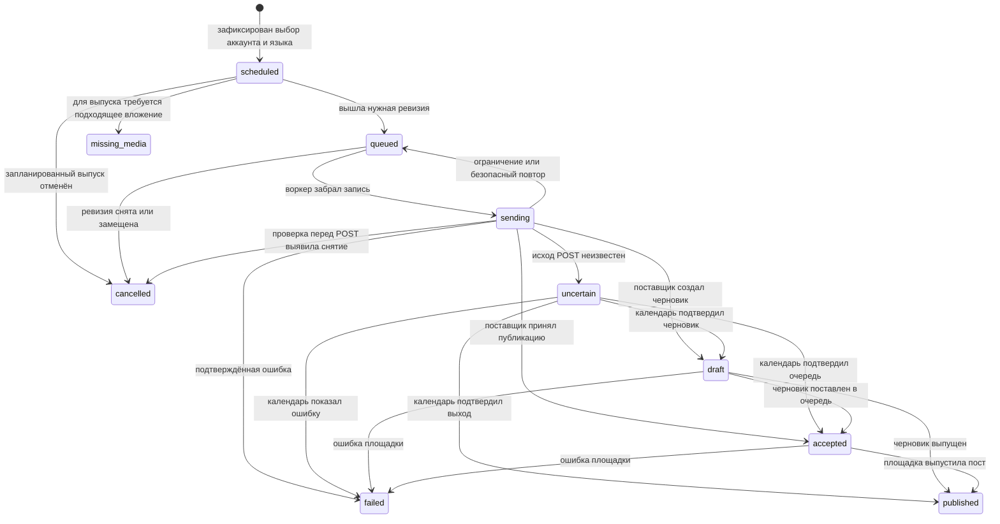

Показаны основные переходы. При неоднозначном совпадении в календаре запись может оставаться `uncertain`. Привязка к опубликованной ревизии проверяется перед отправкой. [Создание записей](../backend/creata/internal/news/postiz_outbox.go) · [Переходы Postiz](../backend/creata/internal/news/postiz_worker.go)

### 18. Последовательность Telegram-дайджеста

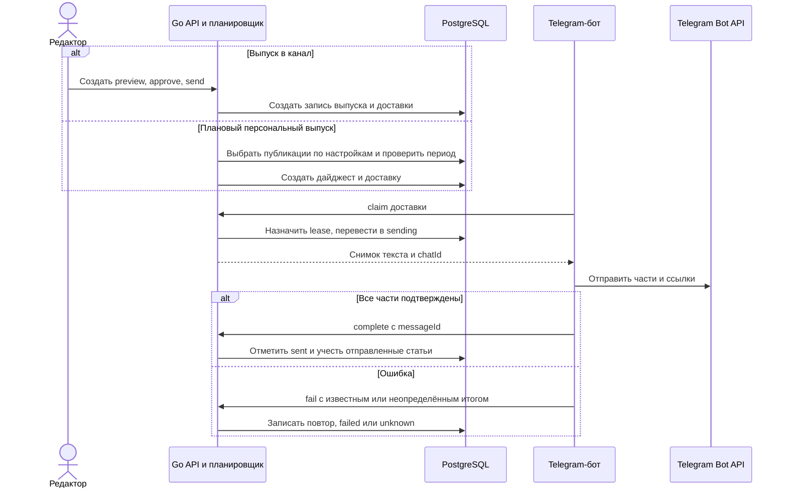

У бота есть канал и персональный режим с языком, темами, частотой, паузой и командой `/digest`. Ручная команда использует отдельные подтверждения отправки, а схема показывает сервисную очередь. Планировщик использует редакционный часовой пояс, по умолчанию `Asia/Qyzylorda`, 09:00 ежедневно или по пятницам для еженедельной подписки. Запись `digest_period` предотвращает повтор планового выпуска за период. В `CREATA_TELEGRAM_CHANNEL_ONLY=1` Go отключает персональный планировщик и ограничивает claim каналом, а бот игнорирует личные команды. [Дайджесты](../backend/creata/internal/news/digests.go) · [Команды бота](../telegram-bot/src/creata/bot.ts) · [Отправка частей](../telegram-bot/src/creata/delivery.ts)

### 19. Состояния доставки Telegram

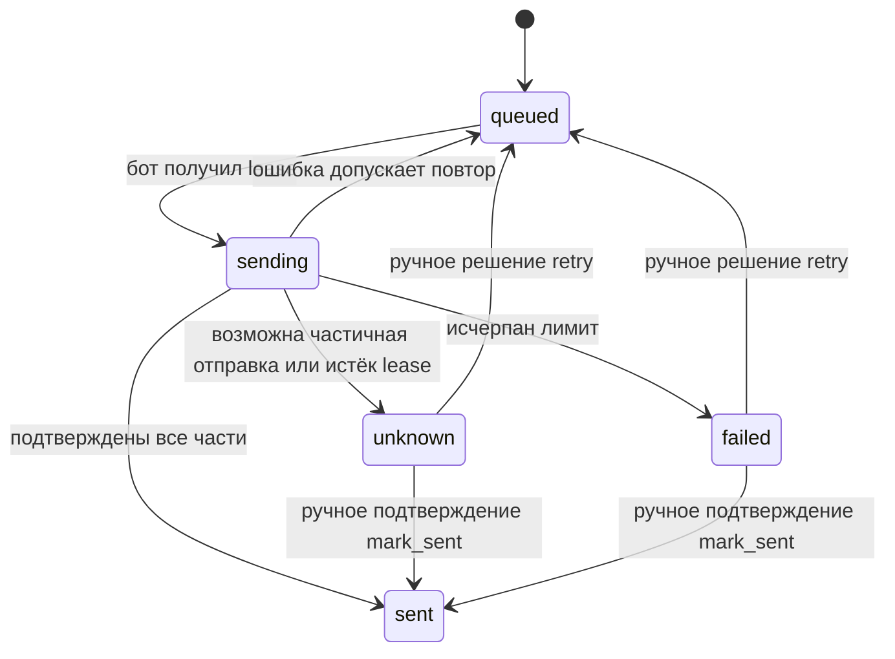

`digest` хранит выпуск, `delivery` — состояние конкретной отправки. Повтор может выполняться автоматически при безопасной ошибке. Частичная или неопределённая отправка требует сверки в Telegram и решения главреда либо администратора. Подтверждение `sent` идемпотентно для соответствующего lease. [Журнал доставки](../backend/creata/internal/news/digests.go) · [Ручное восстановление](../backend/creata/internal/news/delivery_recovery.go)

## API, авторизация и эксплуатация

### Карта API

Префикс запросов приложения — `/api/creata/v1`. В OpenAPI перечислены методы, параметры и JSON-схемы, а рабочие пути определяются регистрацией маршрутов в Go. В текущем OpenAPI часть ключей `paths` задана без префикса, в частности для CMS, медиатеки и ряда операций банка. При прямых HTTP-вызовах эти операции также идут под `/api/creata/v1`.

| Группа | Операции |
| --- | --- |
| `/public/*` | Статьи, регионы, популярное, категории, авторы, возможности, запуски и комментарии, газета, страницы CMS, события. |
| `/auth/*` | `me`, вход через Google/Telegram, callback, logout, локальный dev-login. |
| `/account/*` | Профиль, сохранения, Telegram-link, `followed-stories` и отметка чтения, голоса, комментарии и заявки на запуск. |
| `/admin/articles/*` | Чтение и запись, `actions`, ревизии, исследование, follow-up, черновик графика, превью и журнал Postiz. |
| `/admin/bank/*` | Список, сбор ссылки, доказательства, похожие сюжеты, объединение, отмена объединения/разделение, перевод в черновик или график. |
| `/admin/sources`, `/admin/jobs`, `/admin/runs`, `/admin/settings` | Настройка Hermes, задания, повторы, проверка и запуск источников, AI и правила. |
| Остальные `/admin/*` | Команда, аудит и аналитика, Postiz-аккаунты, каталог запусков и очередь заявок, возможности, авторы, страница follow-up, CMS, медиа, газета, дайджесты и доставки. |
| `/internal/jobs/*`, `/internal/ai*` | Bearer-токен Hermes, claim, heartbeat, checkpoint, complete/fail, конфигурация AI, резерв и учёт расходов. |
| `/internal/bot/*`, `/internal/deliveries/*` | Отдельный Bearer-токен бота, команды и предпочтения, привязка, ручной дайджест, получение и подтверждение доставки. |
| Вне префикса | `GET /health` Go проверяет соединение с PostgreSQL. Есть `/legacy-media/…` и локальный файловый маршрут при использовании диска. |

[OpenAPI 3.1](../backend/creata/openapi.json) · [API-справочник](API-CONTRACT.md) · [Маршруты Go](../backend/creata/internal/news/server.go) · [Генератор TypeScript](../scripts/generate-contracts.ts)

### 20. Последовательность входа и защищённой записи

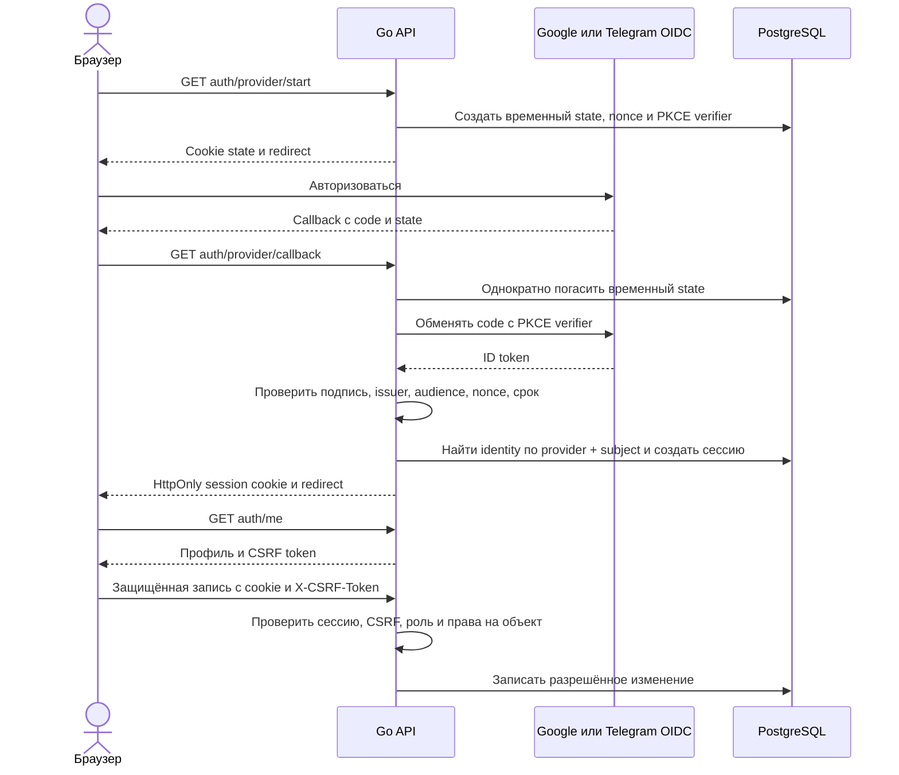

- Идентичность привязана к `provider + subject`. Сессия хранится в PostgreSQL в виде хеша токена. Cookie сессии помечается `HttpOnly` и `SameSite=Lax`, при HTTPS также `Secure`. В API разрешены точные origin из конфигурации. Для разных поддоменов OAuth и cookie используют общий настроенный домен.
- Ключи AI и Exa принимаются на запись и шифруются AES-GCM. Админка показывает факт настройки. Сервисы получают свои credentials. Локальный dev-login доступен при отдельном флаге для loopback, production-конфигурация отклоняет этот режим.
- В production Go ограничивает частоту запросов в памяти процесса. Для доверенных SSR-чтений есть отдельный бюджет с `CREATA_SSR_TOKEN`. Go учитывает цепочку клиентских адресов от настроенных прокси. Next-прокси удаляет служебный SSR-заголовок из входящих браузерных запросов, закрывает `/internal` и ограничивает фактическое тело запроса 12 МиБ.
- В эксплуатации сохраняют PostgreSQL, объектное хранилище и каталог `hermes-state`. Для рабочего контура нужны стабильный секрет сессии, внешний HTTPS, точные OAuth callback URL, credentials провайдеров и права публичного чтения S3/CDN.

[OIDC](../backend/creata/internal/news/oauth.go) · [Сессии и вход](../backend/creata/internal/news/server.go) · [Ключи AI](../backend/creata/internal/news/jobs.go) · [Лимиты](../backend/creata/internal/news/limits.go) · [Прокси](../creatanews/src/app/api/creata/%5B...path%5D/route.ts) · [Эксплуатация](../README.md#data-and-operations)

## Как проверять проект

Базовый запуск из корня репозитория выполняется так.

```sh
bun install --frozen-lockfile
bun run setup:local
docker compose up -d postgres
bun run dev
```

Полная сборка контейнеров запускается через `docker compose up --build -d`. Для адресов нативного запуска используйте `.runtime/local-ports.json`. Файл `.env.example` перечисляет параметры. Реальные значения для OAuth, AI, Telegram, Postiz и S3 задаются в окружении соответствующего сервиса.

| Команда из корня | Что покрывает |
| --- | --- |
| `bun scripts/generate-contracts.ts --check` | Синхронность OpenAPI и сгенерированного TypeScript. |
| `bun run typecheck`, `bun run build` | Типы и сборки workspaces. |
| `bun run test` | Модульные тесты публичного приложения, общих пакетов, редакции, Hermes Admin и бота. |
| `bun run test:api` | Тесты Go. Для PostgreSQL-сценариев нужен отдельный `CREATA_TEST_DATABASE_URL`. CI запускает их с `-race`. |
| `python -m unittest discover -s hermes-worker/tests -v` | Тесты Python, в том числе извлечение доказательств, формат ответа AI, повтор и учёт оплаченных запросов. |
| `bun run test:e2e` | Браузерные сценарии Playwright поверх подготовленного локального стека. |
| `bun run test:pipeline` | Сквозная проверка с отдельной тестовой БД, сборкой сайта, Chromium и HTTP-заглушками внешних интеграций. |

GitHub Actions объединяет проверку контракта, сборку, TypeScript, Bun, Go с тестовой PostgreSQL, Python и сквозной запуск. Отчёт об отдельном сквозном прогоне приложен в аудите от 23 ноября. У реальных OAuth-провайдеров, платного AI и внешних отправок своя приёмка с настроенными сервисами. [Локальная настройка](../scripts/setup-local.ts) · [CI](../.github/workflows/ci.yml) · [Сквозной сценарий](../scripts/verify-pipeline.ts) · [Технический аудит](TECHNICAL-AUDIT-2026-11-23.md)

При подготовке этого документа прошли проверка сгенерированных контрактов и 102 теста Bun. Python запустил 58 тестов, из них 55 прошли и 3 были пропущены. Все 20 диаграмм разобраны Mermaid и отрисованы в Chromium. Сквозной прогон и интеграции с живыми провайдерами относятся к отдельным проверкам.

## Текущие технические границы

- Поиск — подстрочный SQL по локализованному заголовку и тексту. Индексы и cursor pagination применяются к архивной выдаче. Опечатки, морфологическое ранжирование и специализированный поисковый движок за пределами описанной реализации. [SQL поиска](../backend/creata/internal/news/public_archive.go)
- При высокой конкуренции общая advisory lock в `Store.Write` ограничивает пропускную способность записи. Некоторые циклы планировщика всё ещё перебирают документы по типу. Отдельная очередь Postiz использует более узкий SQL claim. [Store](../backend/creata/internal/news/store.go) · [Планировщик](../backend/creata/internal/news/jobs.go) · [Postiz worker](../backend/creata/internal/news/postiz_worker.go)
- Внешние отправки асинхронны. Успех публикации сайта, принятие запроса провайдером и выход на внешней площадке имеют самостоятельные состояния. Неоднозначность фиксируется в журнале доставки. [Доставка Postiz](../backend/creata/internal/news/postiz_worker.go) · [Доставка Telegram](../backend/creata/internal/news/delivery_recovery.go)
- Для перехода с демо на рабочий контур нужны PostgreSQL, HTTPS и настройки хранилища и интеграций. [Демо](DEMO-VERCEL.md) · [Рабочее окружение](../README.md#docker-deployment) · [Аудит](TECHNICAL-AUDIT-2026-11-23.md)
